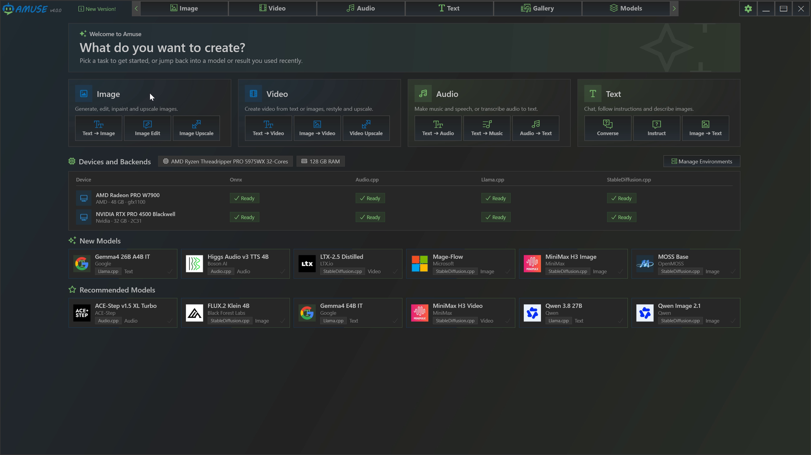

  

  <b>Create images, video, music, speech and text with AI, entirely on your own Windows PC.</b> 
  Nothing is uploaded, and there are no accounts or subscriptions.

  
  
  
  

  <a href="https://github.com/saddam213/AmuseAI/releases/latest"><b>Download</b></a> ·
  <a href="https://github.com/saddam213/AmuseAI/issues"><b>Issues</b></a>

---

## Features

### Image
- **Text to Image**, **Image to Image**, **Image Edit**, **Inpaint** and **Paint to Image**
- LoRA adapters and ControlNet
- Upscale as you generate, or upscale any image afterwards
- Depth, edge, pose and background extractors
- Image Compose, a layered editor with selection and masking tools

### Video
- **Text to Video**, **Image to Video**, **Video to Video**, **Frame to Frame** and **Media to Video**
- Long videos in chunks, with a different prompt per chunk
- Video upscale, frame interpolation and slow motion
- Video Compose, a timeline editor for generated or local clips

### Audio
- **Text to Music** and **Audio to Music**
- **Text to Audio** for speech and sound effects
- **Voice Clone**
- **Audio to Text** transcription
- Audio Compose, a timeline editor for audio

### Text
- **Converse** and **Instruct** with thinking and tool calls
- **Image to Text** with vision models
- Documents, images and audio as context
- Built-in tools: calculator, date and time, weather, Wikipedia, world news, web search, web page, file search, file read, screenshot and more
- **MCP servers**, local or remote

### Library
- **Gallery** and per-tool history for everything you create
- Drag and drop between tools and out to Windows
- Automation for batches

### Models
- **Models** page to browse, search, filter and download every supported model
- Safetensors, GGUF and ONNX support
- Install your own model files, or use the models in your ComfyUI folders

### App
- Runs entirely on your PC with native backends, no Python environment to install
- Dark and light themes, adjustable UI scale
- English, Japanese, Chinese, Korean, German, French, Spanish, Portuguese and Russian

---

## Supported models

Models are downloaded from the **Models** page inside Amuse. You can also install your own GGUF and Safetensors files.

### Image
| Family | Models |
|---|---|
| FLUX | FLUX.1 Schnell, Dev, Kontext and Krea Dev · FLUX.2 Dev and Klein 4B / 9B · FLUX.3 Klein 6B |
| Qwen Image | Qwen Image, Qwen Image Edit, Qwen Image 2.1 |
| Z-Image | Z-Image, Z-Image Turbo, Z-Image L2P |
| Stable Diffusion | StableDiffusion XL and community checkpoints · StableDiffusion 3 and 3.5 |
| Chroma | Chroma, Chroma Radiance, Chroma2 Kaleidoscope |
| MiniMax | MiniMax H3 Image |
| MOSS | MOSS Base, MOSS SFT, MOSS Image Heal |
| More | Anima · Boogu · Ernie Image · Fibo 2.0 · HiDream O1 · Ideogram 4 · Iris · Krea2 · Lens · LLaDA-Image · LongCat Image · Mage-Flow · Ming Image · Ovis Image · P-H3 Image · PixArt · SenseNova U1.5 |

### Video
| Family | Models |
|---|---|
| Wan | Wan 2.1 and 2.2: T2V, I2V, VACE, 5B and 14B |
| LTX | LTX-2.3 and LTX-2.5, Dev and Distilled |
| MiniMax | MiniMax H3 Video, MiniMax H3 Reference |
| HunyuanVideo | HunyuanVideo 1.5 480p and 720p |

### Audio
| Task | Models |
|---|---|
| Music | ACE-Step v1.5 and v1.5 XL · HeartMuLa · MiniMax Music 3 · Stable Audio 3 · YuE2 |
| Sound effects | MOSS SoundEffect v2 · Stable Audio 3 Small SFX |
| Speech and voice cloning | Chatterbox Turbo · Fish Audio S2 Pro · Higgs Audio v3 TTS · MagpieTTS · NeuTTS · OmniVoice · Qwen3 TTS · Supertonic v3 · Tiny Voca · VoxCPM2 · Voxtral TTS |
| Speech to text | Canary Flash · Cohere Transcribe · CrisperWhisper 2.0 · Granite Speech 5.0 · Higgs Audio v3 STT · MOSS Transcribe Diarize · Parakeet TDT v3 · Qwen3 ASR · VibeVoice ASR · VoxMel · Voxtral Realtime |

### Text
| Family | Models |
|---|---|
| Qwen | Qwen 3.0, 3.5, 3.6 and 3.8, from 4B to 35B, with vision |
| Gemma | Gemma 4, from E2B to 31B, with vision |

### Upscale and extract
More than 80 upscalers, including SeedVR2 and RelayVSR, plus depth, edge, pose and background removal extractors.

---

## System requirements

| | Minimum | Recommended |
|---|---|---|
| **Operating system** | Windows 10 (version 1809 or later), 64-bit | Windows 11, 64-bit |
| **Graphics card** | Any GPU with Vulkan support | NVIDIA RTX, or a recent AMD Radeon card |
| **Video memory (VRAM)** | 8 GB for smaller image models | 16 GB or more for video and larger models |
| **Disk space** | 20 GB free for a few models | 100 GB or more on a fast SSD |

### GPU support

Amuse runs models on your graphics card through backends. You don't install any of them yourself: Amuse downloads the right one for your hardware the first time it starts.

| Backend | Used for | NVIDIA | AMD | Intel |
|---|---|---|---|---|
| StableDiffusion.cpp | Images and video | CUDA or Vulkan | ROCm or Vulkan | Vulkan |
| Audio.cpp | Music, speech and transcription | CUDA or Vulkan | Vulkan | Vulkan |
| Llama.cpp | Language models | CUDA or Vulkan | ROCm or Vulkan | Vulkan |
| ONNX Runtime | Upscalers, extractors and interpolation | DirectML | DirectML | DirectML |

- **CUDA** is the fastest option on NVIDIA RTX cards. CUDA 13 needs driver version `580.65` or later; choose CUDA 12 for older cards or drivers.
- **ROCm** is the fastest option on newer AMD Radeon cards.
- **Vulkan** works on almost any graphics card and is the safe choice if you're unsure.

> **Note:** Actual compatibility and performance depend on the GPU model, driver version and backend being used.

---

## Install

1. Download the installer from the **[latest release](https://github.com/saddam213/AmuseAI/releases/latest)**.
2. Run it and start **Amuse** from the Start menu.
3. Follow the setup window to choose a model folder and install the backends for your graphics card.
4. Open the **Models** page, download a model and start creating.

> **Windows 11:** If a backend fails to install, run Amuse with `Run as administrator` and install it again from **Home → Manage Environments**.

---

## Documentation

The **[Amuse documentation](docs/README.md)** has a short video and step-by-step instructions for every part of the app.

| | |
|---|---|
| **Getting started** | [Installing Amuse](docs/getting-started/installation.md) · [First run](docs/getting-started/first-run.md) · [Your first image](docs/getting-started/your-first-image.md) |
| **Models** | [The Models page](docs/models/models-page.md) · [Installing your own models](docs/models/local-models.md) |
| **Image** | [Text to Image](docs/image/text-to-image.md) · [Image Edit](docs/image/image-edit.md) · [LoRA and inline upscale](docs/image/lora-and-upscale.md) |
| **Video** | [Text to Video](docs/video/text-to-video.md) · [Chunking](docs/video/chunking.md) · [Media to Video](docs/video/media-to-video.md) |
| **Audio** | [Text to Music](docs/audio/text-to-music.md) · [Text to Speech](docs/audio/text-to-speech.md) · [Speech to Text](docs/audio/speech-to-text.md) |
| **Text** | [Converse and Instruct](docs/text/converse-and-instruct.md) · [Tool calls](docs/text/tool-calls.md) |
| **Tools** | [Upscale](docs/tools/upscale.md) · [Interpolate](docs/tools/interpolate.md) · [Extract](docs/tools/extract.md) · [Compose](docs/compose.md) |
| **Library** | [Gallery and history](docs/library/gallery-and-history.md) · [Settings](docs/settings.md) |

---

## Build from source

Amuse is a WPF application built on **.NET 10** and the [TensorStack](https://github.com/saddam213/TensorStack) SDK.

1. Install **Visual Studio 2026** with the **.NET desktop development** workload.
2. Clone the repository and open `Amuse.sln`.
3. Allow Visual Studio to restore the NuGet packages.
4. Select the `Debug` or `Release` configuration and build with **Build → Build Solution** (`Ctrl+Shift+B`).
5. Run `Amuse.exe` from the build output directory.

Each backend runs in its own host process (`Amuse.Host.StableDiffusionCpp`, `Amuse.Host.LlamaCpp`, `Amuse.Host.AudioCpp` and `Amuse.Host.OnnxRuntime`), which the app starts and talks to over named pipes.

---

## Contributing

Contributions to Amuse are welcome! 
Whether you want to contribute code, report issues, suggest improvements, or help in other ways, your contributions are appreciated.

Thank you to everyone who contributes to Amuse and helps make the project better!

---

## License

Amuse is licensed under the [Apache License 2.0](LICENSE).

> **Note:** Compiled binaries are licensed under the Amuse 2.0 License due to the inclusion of bundled third-party software and dependencies, which may be subject to their own licensing requirements.

---

## Attribution & Dependencies

Amuse is made possible in part by these excellent open-source projects:

- `TensorStack` https://github.com/saddam213/TensorStack
- `stable-diffusion.cpp` https://github.com/leejet/stable-diffusion.cpp
- `llama.cpp` https://github.com/ggml-org/llama.cpp
- `audio.cpp` https://github.com/0xShug0/audio.cpp
- `ONNX Runtime` https://github.com/microsoft/onnxruntime
- `MCP C# SDK` https://github.com/modelcontextprotocol/csharp-sdk
- `OpenCvSharp` https://github.com/shimat/opencvsharp
- `SkiaSharp` https://github.com/mono/SkiaSharp
- `PdfPig` https://github.com/UglyToad/PdfPig
- `Open XML SDK` https://github.com/dotnet/Open-XML-SDK
- `Markdig` https://github.com/xoofx/markdig
- `ColorCode` https://github.com/CommunityToolkit/ColorCode-Universal
- `Serilog` https://github.com/serilog/serilog
- `WebLookup` https://github.com/iyulab/WebLookup
