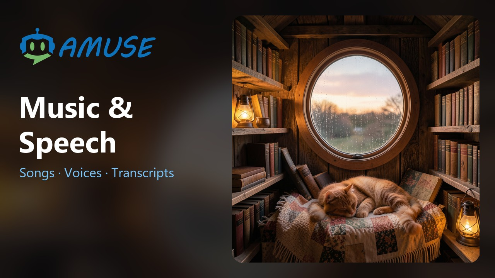
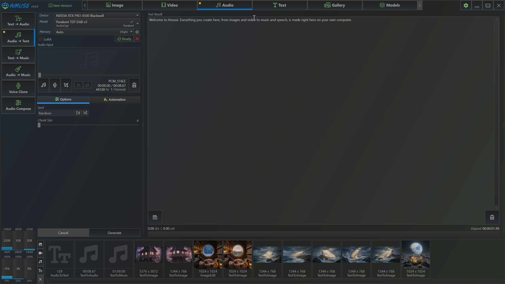

# Speech to Text

*Video: Music, speech and transcription in Amuse (Speech to Text starts at 2:57).*

**Audio → Text** transcribes speech from an audio or video file into text. It's useful for notes, subtitles and turning recordings into documents you can search or give to a language model.

**Before you start:** download a speech recognition model from the **Models** page. **Parakeet TDT 0.6B v3** is small (about 2 GB of memory), fast and accurate for English and 24 other European languages.

---

## 1. Load a transcription model

1. Click **Audio** at the top, then **Audio → Text** on the left.
2. Choose the **Device** and **Model**, and click **Load**.

## 2. Add the audio

Drag an audio item from your **history** onto **Audio Input**, or use the buttons under it:

| Button | What it does |
|---|---|
| ♪ **Open** | Open an audio file (MP3, WAV, FLAC, M4A, AAC, OGG) or the soundtrack of a video (MP4, MOV, MKV, WEBM). |
| 🎙 **Record** | Record from your microphone. |
| **Crop** | Transcribe only part of the audio. |

The box shows the format, length, sample rate and channels of the audio once it's loaded.

## 3. Generate

Click **Generate**. The text appears in **Text Result** as it's recognised. Select it to copy, or use the disk button to save it as a `.txt` or `.md` file. Every transcript is also saved to your history.

| Option | What it does |
|---|---|
| **Language** | The spoken language, for models that ask for it (Canary, CrisperWhisper). Other models detect it. |
| **Chunk Size** | Splits long recordings into chunks of this many seconds. 0 uses the model's default. |

### Live transcription

With **Voxtral Mini 4B Realtime**, a **Live Microphone** section appears. Choose your microphone and click the microphone button: the text appears while you speak. Click the red button to stop.

---

## Tips

- For many files at once, use **Input Files** on the **Automation** tab and choose a folder.
- **MOSS Transcribe Diarize** is designed for conversations with several people and tells the speakers apart.
- Send a transcript to **Text → Instruct** to summarise it or turn it into notes.

## Troubleshooting

| Problem | Try this |
|---|---|
| "Speech recognition requires an input audio." | Add audio to **Audio Input** before clicking Generate, then click **Load** again if the model shows **Load**. |
| Words are missing or wrong | Use a model that supports the language, and reduce background noise in the recording. |

---

**Related:** [Text to Speech](text-to-speech.md) · [Text to Music](text-to-music.md)
