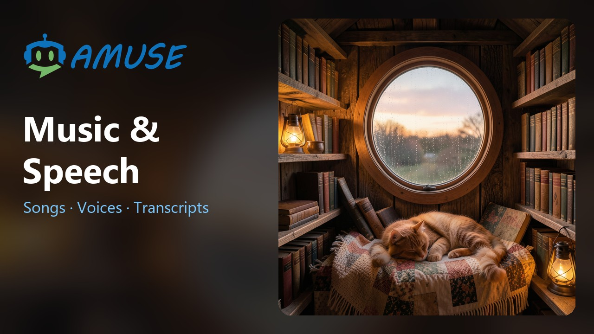
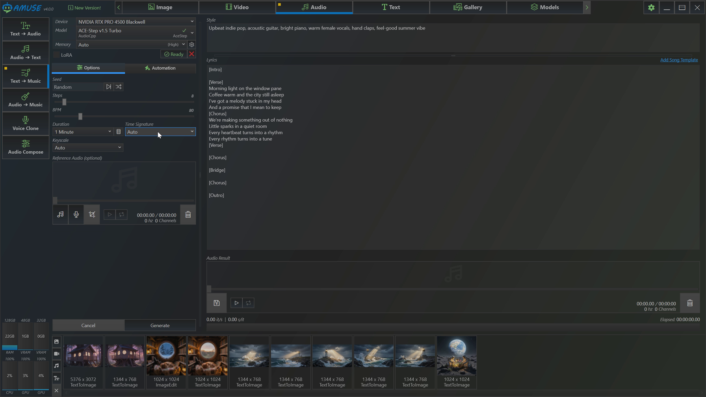
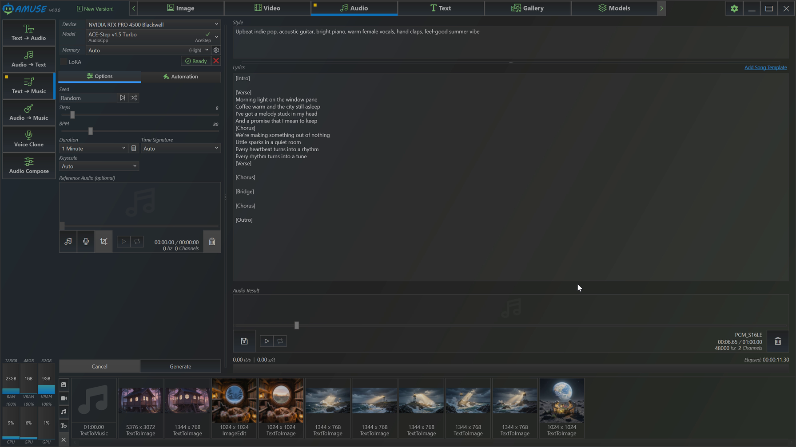

# Text to Music

[](https://youtu.be/iKQMo2gLIuo)

*Video: Music, speech and transcription in Amuse (Text to Music starts at 0:16).*

**Text to Music** writes a complete song, with vocals and instruments, from a style description and your lyrics. A one minute song takes only a few seconds on a modern graphics card.

**Before you start:** download a music model from the **Models** page (set **Media Type** to **Audio**). The example uses **ACE-Step v1.5 Turbo** (about 8 GB of memory). Music models run on the **Audio.cpp** backend, so it needs to show **Ready** on the Home page.

---

## 1. Load a music model

1. Click **Audio** at the top of the window, then **Text → Music** on the left.
2. Choose the **Device** and **Model**, and click **Load**.



If a model is already loaded in another view, Amuse asks what to do with it: **Unload** frees its memory first, **Continue** keeps both loaded (if your card has room), and **Cancel** stops.

## 2. Describe the style

In **Style**, describe the genre, instruments, vocals and mood, for example:

```
Upbeat indie pop, acoustic guitar, bright piano, warm female vocals, hand claps, feel-good summer vibe
```

## 3. Write the lyrics

Click **Add Song Template** above the **Lyrics** box. It adds section tags (`[Intro]`, `[Verse]`, `[Chorus]`, `[Bridge]`, `[Outro]`), so you only need to write your lines under each one:

```
[Verse]
Morning light on the window pane
Coffee warm and the city still asleep
...

[Chorus]
We're making something out of nothing
Little sparks in a quiet room
...
```

Sections you leave empty are played as instrumentals. Leave **Lyrics** empty altogether for an instrumental track. (**Add Song Template** appears for the ACE-Step models.)

## 4. Options

| Option | What it does |
|---|---|
| **Seed** | **Random** gives a different song each time; a fixed number repeats the same song. |
| **Steps** | Refinement steps. The Turbo models need 8; the full models use 50. |
| **Guidance** | How closely the song follows the style (hidden for Turbo models). |
| **BPM** | The tempo, from 30 to 300 beats per minute (ACE-Step). |
| **Duration** | The length of the song: **Auto**, 30 seconds, or 1 to 10 minutes. The button beside it lets you type an exact number of seconds. |
| **Time Signature** | **Auto**, 2/4, 3/4, 4/4 or 6/8 (ACE-Step). |
| **Keyscale** | **Auto**, or a key such as C major or F# minor (ACE-Step). |
| **Reference Audio (optional)** | An existing track whose sound and style the new song should follow (ACE-Step). |

## 5. Generate

Click **Generate**. The song plays in **Audio Result** as soon as it's ready, and is saved to your history. The disk button saves it as WAV, MP3, M4A, AAC or OGG.



---

## Tips

- Name the instruments and the type of voice you want; the model follows specific words better than general ones.
- Keep lines short and regular, like real song lyrics, so they fit the beat.
- Use **Seed Batch** on the **Automation** tab to make several versions and keep the best one.
- To remix or cover an existing song, use **Audio → Music**.

---

**Related:** [Text to Speech](text-to-speech.md) · [Speech to Text](speech-to-text.md)
