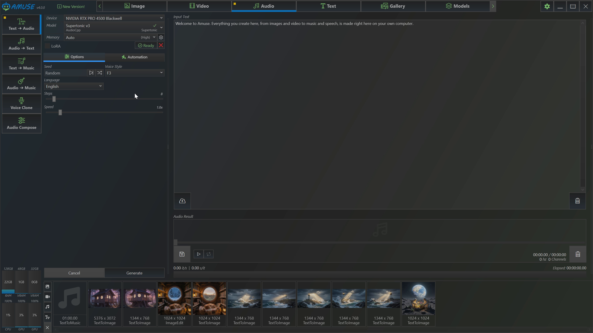

# Text to Speech

*Video: Music, speech and transcription in Amuse (Text to Speech starts at 2:00).*

**Text to Audio** reads your text aloud in a natural voice. It's fast: a few sentences take less than a second. The narration in the Amuse videos is made this way, with **Supertonic v3**.

**Before you start:** download a speech model from the **Models** page. **Supertonic v3** is small (about 2 GB of memory), speaks 31 languages and has ten voices.

---

## 1. Load a speech model

1. Click **Audio** at the top, then **Text → Audio** on the left.
2. Choose the **Device** and **Model**, and click **Load**.

## 2. Type the text

Type or paste what you want to hear in **Input Text**, or click the upload button under the box to open a `.txt` file.

## 3. Options

The options depend on the model. For Supertonic v3:

| Option | What it does |
|---|---|
| **Voice Style** | The voice: **F1** to **F5** (female) and **M1** to **M5** (male). |
| **Language** | The language of the text. |
| **Steps** | Quality steps (8 by default). |
| **Speed** | How fast the voice speaks, from 0.5× to 5×. |
| **Seed** | Small variations in delivery. |

Other models add their own options, for example an **Emotion** (NeuTTS 2E) or an **Instruction** box where you describe the voice in words (OmniVoice, Qwen3 TTS). Sound-effect models such as **Stable Audio 3 Small SFX** and **MOSS SoundEffect** use **Duration** instead of a voice.

## 4. Generate

Click **Generate**. The speech plays in **Audio Result** and is saved to your history. Save it with the disk button, or drag it from history into another tool, such as **Audio → Text** or the video editor.

---

## Tips

- Punctuation shapes the delivery: commas add short pauses, and full stops add longer ones.
- Write numbers and abbreviations the way they should be said ("twenty twenty-six", "C P U").
- For long scripts, use **Input Files** on the **Automation** tab to read every text file in a folder.
- To speak in a particular person's voice from a short recording, use **Voice Clone**.

---

**Related:** [Speech to Text](speech-to-text.md) · [Text to Music](text-to-music.md)
