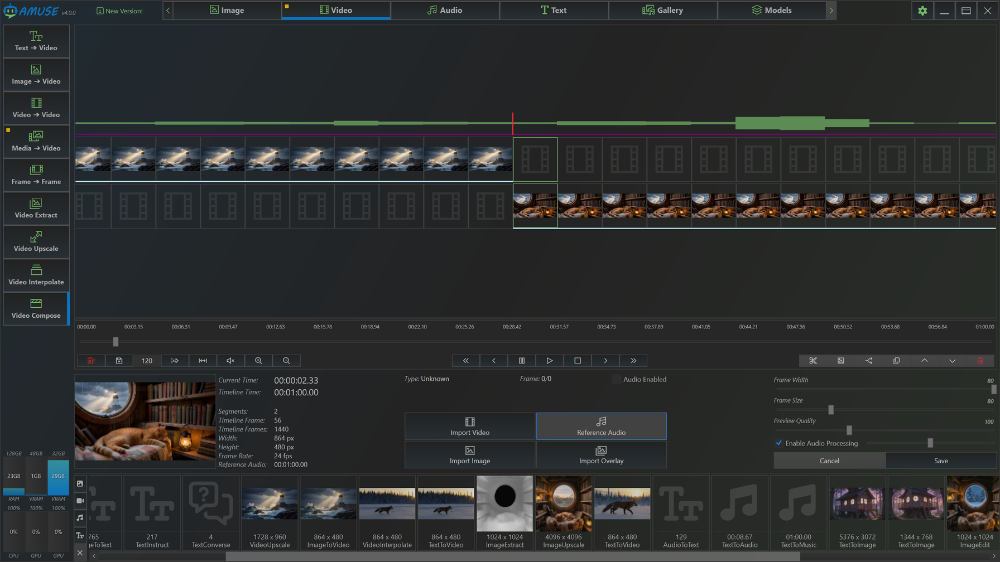

# Compose and automation

Amuse includes simple editors for putting your results together, without any AI model, and an **Automation** tab in most tools for running batches.

---

## Video Compose

**Video → Video Compose** joins clips into one video on a timeline, with an optional soundtrack.

1. Drag videos from your **history** onto the timeline, or click **Import Video**. Each video becomes a *segment*. **Import Image** adds a still image as a segment, and **Import Overlay** adds an image over the video.
2. Click **Reference Audio** (or drag a song onto it) to add a soundtrack. The timeline stretches to the length of the audio and shows its waveform.
3. Select a segment to work on it. The segment buttons (top right of the timeline) **Split** it at the playhead, **Copy** it, move it **Up** or **Down**, **Remove** frames or the whole segment, or save the current frame to history. **Audio Enabled** turns a segment's own sound on or off.
4. Use the play controls to preview, and the zoom buttons and **Frame Width** / **Frame Size** sliders to change the timeline view.
5. Click **Save Video** (the disk button on the left of the timeline) to save the result to your history.

The details panel shows the current time, total length, number of segments and frames, size, frame rate and reference audio. Clips should have the same size and frame rate (most results from one model do).

| Timeline button | What it does |
|---|---|
| **Clear Timeline** | Remove everything. |
| **Save Video** | Save the timeline to history. |
| **Extend Timeline** | Add the number of frames typed beside it. |
| **Trim Timeline** | Trim the timeline to its content. |
| **Remove Reference Audio** | Remove the soundtrack. |
| **Zoom In** / **Zoom Out** | Change the timeline scale. |

## Audio Compose

**Audio → Audio Compose** builds an audio track from several clips, for example speech over a song.

- **Import Audio** (or drag from history) adds a clip at the playhead. **Reference Video** shows a video along the timeline so you can line the sound up with it.
- Select a clip to set its **Volume** or **Mute** it, and use the clip buttons to move it to the playhead, trim its start or end, split it, copy it or remove it.
- **Save Audio** mixes the clips and saves the result to history. **Save Video** saves the reference video with your mix as its soundtrack.

## Image Compose

**Image → Image Compose** arranges images and text in layers. **Add Image Layer** and **Add Text Layer** add layers; set each layer's position, size, rotation, font and colour, the canvas size and background colour, then **Save**.

---

## Automation (batches)

Most tools have an **Automation** tab next to **Options**. When it's selected, **Generate** becomes **Automate**, and the same settings run many times:

| Automation | Available in | What it does |
|---|---|---|
| **Seed Batch** | Image, video and audio tools | Makes **Count** results, each with a different seed. |
| **Prompt Lines** | Image and video tools, Instruct | One result per line of a `.txt` file, with the line placed in front of the main prompt. |
| **Prompt Files** | Image and video tools, Instruct | One result per text file in a folder. |
| **Input Files** | Image to Image, Image Edit, Image to Video, Video to Video, upscale, extract, interpolate, Text to Audio, Audio to Text, Image to Text | One result per file in a folder. |

| Option | What it does |
|---|---|
| **Output History** | Adds each result to history (on by default). |
| **Output Location** / **Output Folder** | Also saves each result to a folder of your choice. |

A progress bar shows how far the batch has got, and **Cancel** stops it.

See [Text to Image](image/text-to-image.md#5-make-a-batch-automation) for a worked example.

---

**Related:** [Gallery, history and drag and drop](library/gallery-and-history.md) · [Text to Image](image/text-to-image.md)
