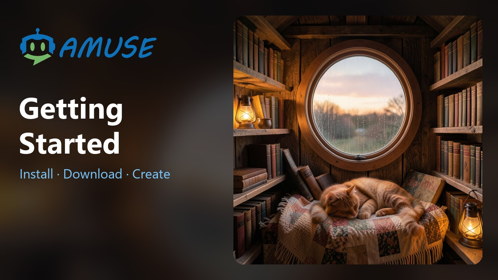
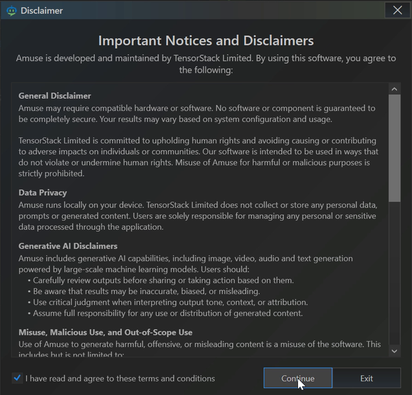
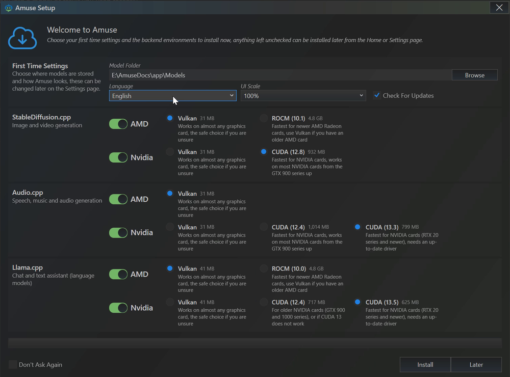
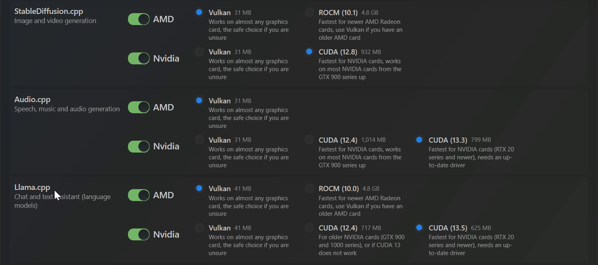
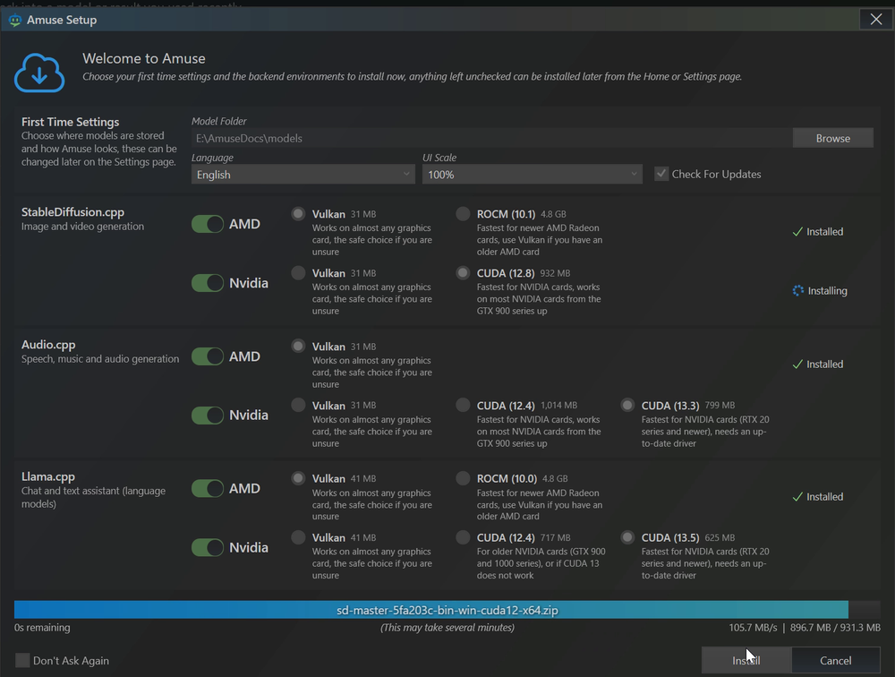
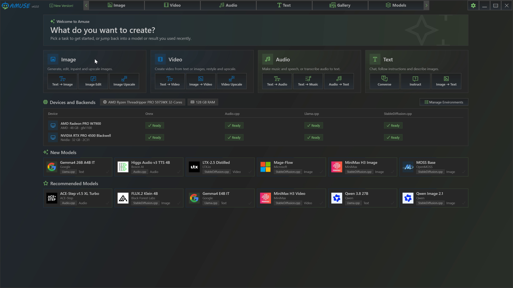

# First run

*Video: Getting started with Amuse (first run starts at 0:19).*

## The disclaimer

The first time you start Amuse, it shows a short disclaimer covering safe and responsible use, privacy and your responsibilities. Read it, tick **I have read and agree to these terms and conditions**, and click **Continue**. Clicking **Exit** closes Amuse.

You only see it once.

## Amuse Setup

Next, the **Amuse Setup** window opens. It asks where to keep your models, the language and size of the interface, and which **backends** to install. Backends are the engines that run AI models on your graphics card. Everything here can be changed later.

---

## 1. Choose a model folder

Models are large files (usually 4 to 20 GB each), so choose a folder on a drive with plenty of free space, preferably a fast SSD.

1. Next to **Model Folder**, click **Browse**.
2. Choose or create a folder, for example `D:\Amuse\Models`, and click **Select Folder**.

Amuse creates its own sub-folders inside (`diffusion_models`, `text_encoders`, `vae`, `loras`, `llm`, `upscale_models` and others), with a layout similar to ComfyUI's. Files you already have elsewhere can be used where they are; see [Model search folders](../models/local-models.md#use-your-comfyui-models-model-search-folders).

> You can move the model folder later from **Settings → General**.

## 2. Language, UI scale and updates

| Option | What it does |
|---|---|
| **Language** | The language of the Amuse interface. |
| **UI Scale** | The size of the interface, from 50% to 300%. Amuse picks a size that fits your screen. |
| **Check For Updates** | When ticked, Amuse checks for a new version each time it starts and shows **New Version!** at the top of the window. |

> To switch between the **Dark** and **Light** themes, use **Settings → General → Theme**.

## 3. Choose your backends

Amuse lists the graphics cards it found and the backends each one can use. It has already selected the best option for each card, so in most cases you can leave these as they are.

| Backend | Used for |
|---|---|
| **StableDiffusion.cpp** | Image and video generation |
| **Audio.cpp** | Music, speech and speech recognition |
| **Llama.cpp** | Language models: chat, instructions and describing images |

For each backend and graphics card you'll see the available versions with their download size:

| Option | Best for |
|---|---|
| **CUDA** | NVIDIA cards. The fastest option on RTX cards. CUDA 13 needs a recent driver, so pick CUDA 12 for older cards or drivers. |
| **ROCm** | Newer AMD Radeon cards. Fast, but a large download. |
| **Vulkan** | Almost any graphics card: AMD, NVIDIA or Intel. The safe choice if you're unsure. |

**If you have more than one graphics card,** Amuse sets up backends for each of them, and you choose which card to use every time you load a model. Turn off the switch next to a card only if you won't use it for AI, which saves download time and disk space.

## 4. Install

Click **Install**. Each backend downloads and sets itself up. A progress bar shows the current file, speed and time remaining. This usually takes a few minutes.

Clicking **Later** skips this step. You can install, update or add backends at any time from **Home → Manage Environments** or **Settings → Environments**.

> If you skip some backends, Amuse offers them again the next time it starts. Tick **Don't Ask Again** to stop that. You can turn the reminder back on from **Settings → General → Reset Dialogs**.

---

## The Home page

When setup finishes you're on the **Home** page.

| Area | What it shows |
|---|---|
| **What do you want to create?** | A shortcut to every tool, grouped into **Image**, **Video**, **Audio** and **Text**. |
| **Devices and Backends** | Each device (CPU and graphics cards) and whether each backend is **Ready** or **Not Installed** on it. **Manage Environments** installs or updates backends. |
| **Recently Used Models** | Appears once you've used Amuse: the models you loaded most recently, so you can jump straight back in. |
| **New Models** | Models recently added to Amuse. |
| **Recommended Models** | Good starting models for each kind of media. Click one to open it on the Models page. |

The tabs along the top (**Image**, **Video**, **Audio**, **Text**, **Gallery** and **Models**) are always available, and the gear icon opens **Settings**.

---

**Next:** [Your first image →](your-first-image.md)
