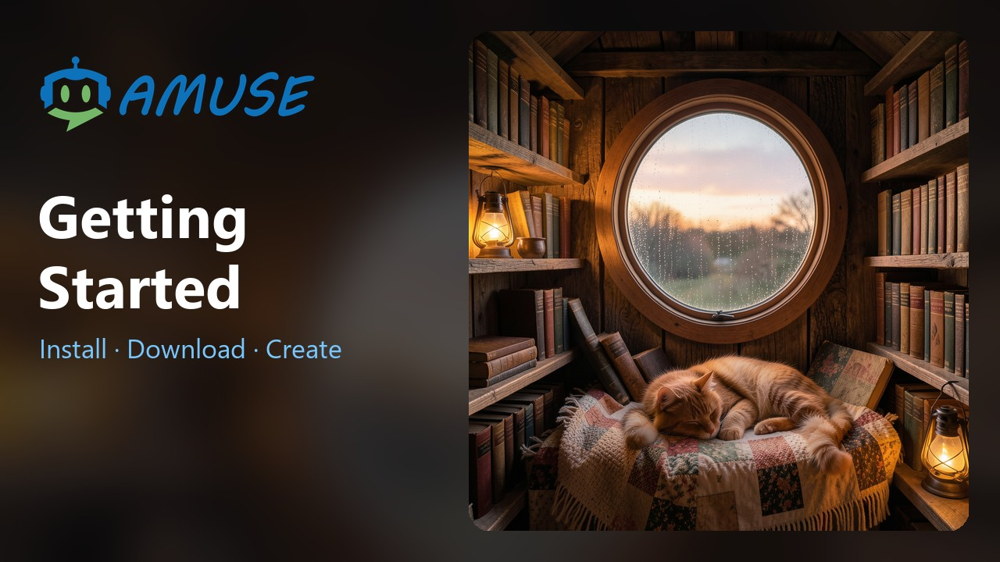
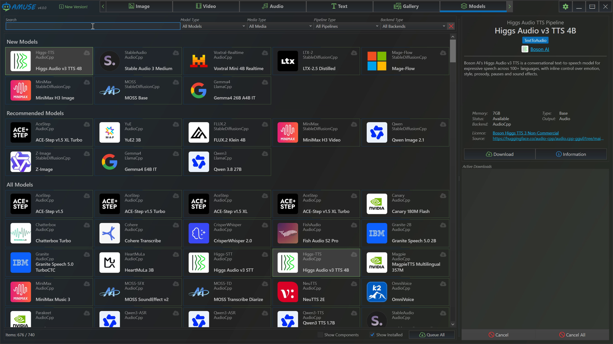
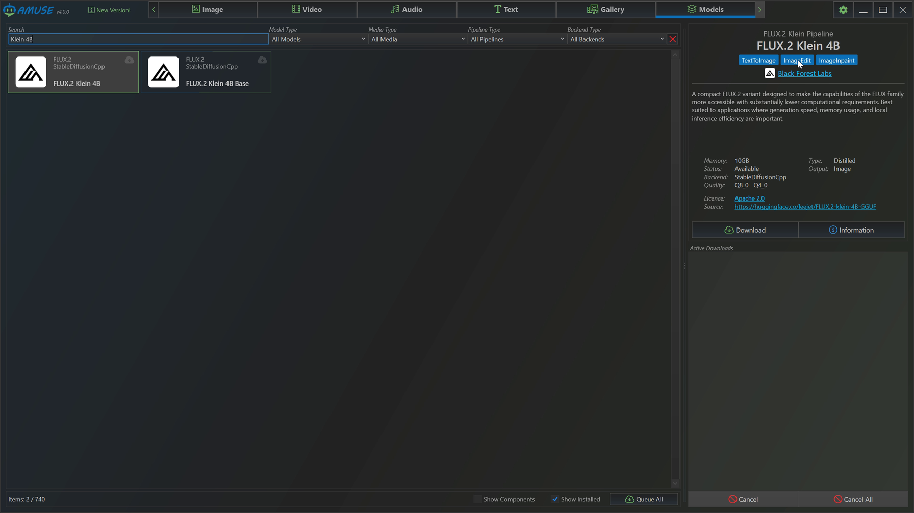
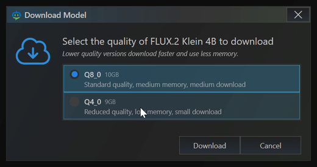
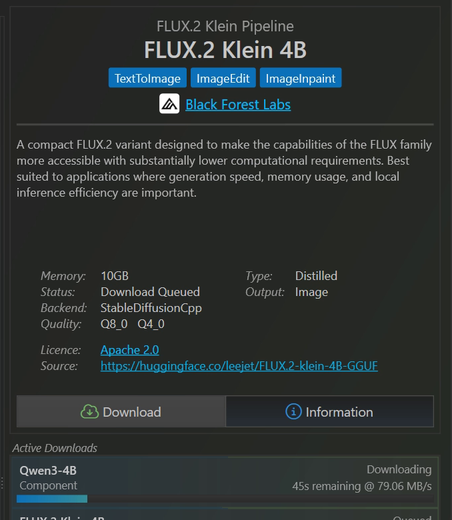
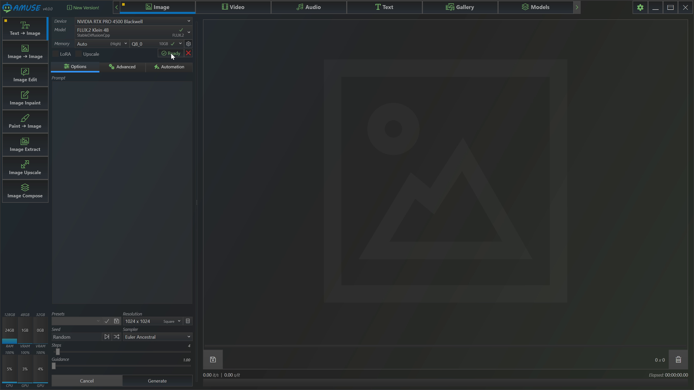
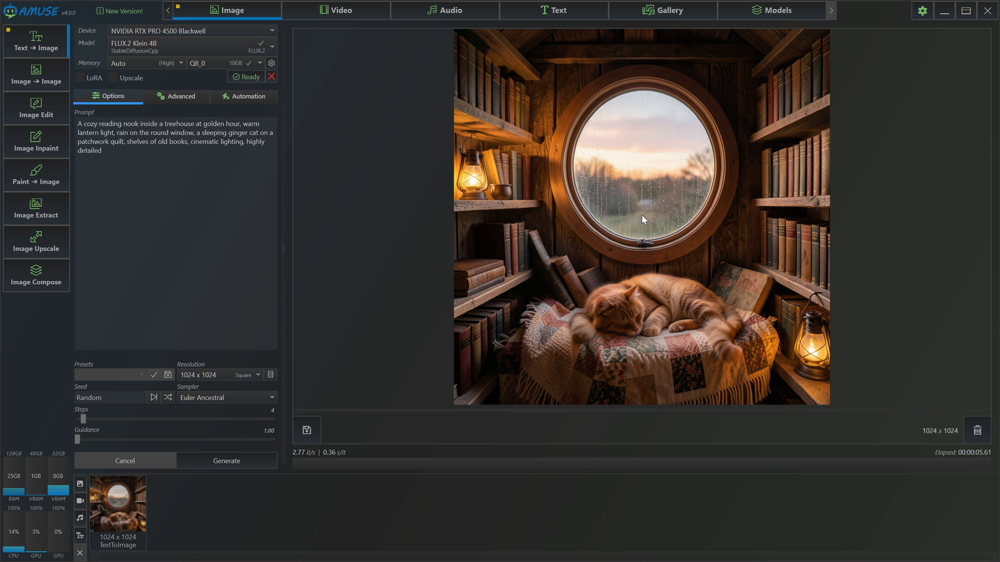
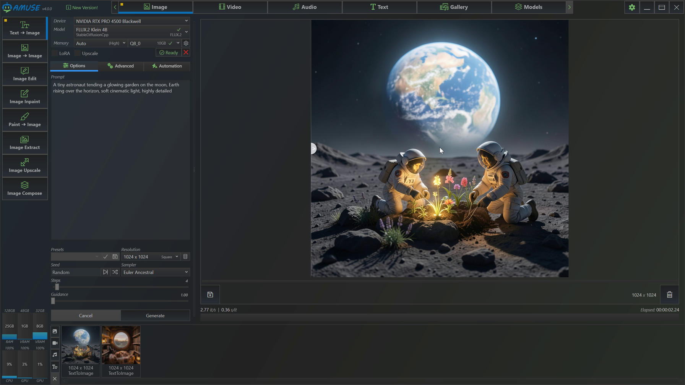

# Your first image

[](https://youtu.be/coa8E5XWKUg)

*Video: Getting started with Amuse (downloading a model starts at 1:59).*

In this guide you download **FLUX.2 Klein 4B**, a fast, high quality image model, and use it to create your first image with **Text to Image**.

**Before you start:** install the **StableDiffusion.cpp** backend for your graphics card (see [First run](first-run.md)). FLUX.2 Klein 4B needs about 10 GB of memory at Q8_0, or a little less at Q4_0.

---

## 1. Download a model

1. Click **Models** at the top of the window.

   

   Every model Amuse supports is listed here, grouped into **New Models**, **Recommended Models** and **All Models**. Use the filters along the top to narrow the list:

   | Filter | Use it to |
   |---|---|
   | **Search** | Find a model by name |
   | **Model Type** | Show only base models, LoRA adapters, ControlNets, upscalers, extractors, and so on |
   | **Media Type** | Show only image, video, audio or text models |
   | **Pipeline Type** | Show only one model family, for example FLUX.2 |
   | **Backend Type** | Show only models for one backend |
   | **Show Installed** | Include models you have already downloaded |
   | **Show Components** | Include shared parts such as text encoders and VAEs |

2. In **Search**, type `Klein 4B` and click **FLUX.2 Klein 4B**.

   The panel on the right shows what the model can do (**TextToImage**, **ImageEdit**, **ImageInpaint**), a short description, its memory size, backend and the available qualities.

   

3. Click **Download**, choose a quality and click **Download** again.

   

   | Quality | Size | Choose it when |
   |---|---|---|
   | **Q8_0** | 10 GB | You have 12 GB of video memory or more. Best quality. |
   | **Q4_0** | 9 GB | You have less video memory, or want a smaller download. |

4. The download appears under **Active Downloads**, with its speed and time remaining. It runs in the background, so you can keep using Amuse. Anything the model needs, such as its text encoder, is downloaded with it.

   

> **Tip:** If a download fails, click **Retry** under Active Downloads. **Cancel** stops the selected download, and **Cancel All** stops them all.

---

## 2. Open Text to Image and load the model

1. Click **Image** at the top of the window. **Text → Image** is selected on the left.
2. Choose the **Device** to run on. If you have more than one graphics card, pick the one you want to use. Each card needs its backend installed (see [First run](first-run.md)).
3. In **Model**, choose **FLUX.2 Klein 4B**. Installed models are marked with a tick.
4. Click **Load**. When the button changes to **Ready**, the model is loaded.

   

| Control | What it does |
|---|---|
| **Device** | The graphics card (or CPU) that runs the model |
| **Model** | The model to use. Only models that support the current tool are listed. |
| **Memory** | How the model uses video memory. **Auto** chooses for you. |
| **Quality** | Which downloaded quality to use, for example Q8_0 |
| **LoRA** | Add LoRA adapters to change the style (see [LoRA and inline upscale](../image/lora-and-upscale.md)) |
| **Upscale** | Upscale each image as it's generated (see [LoRA and inline upscale](../image/lora-and-upscale.md)) |
| **Load / Ready** | Loads the model; the red **✕** unloads it to free memory |

---

## 3. Write a prompt and generate

1. Click in the **Prompt** box and describe the image you want. Be specific about the subject, setting, lighting and style. For example:

   ```
   A cozy reading nook inside a treehouse at golden hour, warm lantern light,
   rain on the round window, a sleeping ginger cat on a patchwork quilt,
   shelves of old books, cinematic lighting, highly detailed
   ```

2. Click **Generate**. A preview appears as the image forms, and the finished image replaces it a few seconds later.

   

3. Your image is saved to the **history** strip along the bottom. Click a thumbnail to view it again, or drag it into another tool (for example **Image → Image**). Everything you make is also in the **Gallery**.

4. To try another idea, change the prompt and click **Generate** again. With **Seed** set to **Random**, every click gives a new image, even with the same prompt.

   

### Options

These are set to good defaults for the model you load, so you can leave them alone at first.

| Option | What it does |
|---|---|
| **Presets** | Save and reuse your favourite settings |
| **Resolution** | Image size. The list shows the sizes the model works best at, such as 1024 x 1024 (square). |
| **Seed** | The random starting point. **Random** gives a new image every time; enter a number to repeat a result. |
| **Sampler** | The method used to build the image step by step |
| **Steps** | How many refinement steps to run. FLUX.2 Klein is a distilled model, so 4 steps is enough. |
| **Guidance** | How strictly the image follows the prompt. Distilled models like Klein use 1.0. |

The **Advanced** tab has more options, and **Automation** runs batches of prompts. See [Text to Image](../image/text-to-image.md) for every option.

### Saving an image

Click the **save** icon under the image to save it anywhere on your PC, or drag the thumbnail from the history strip into a folder in File Explorer. The **delete** icon removes the current result.

---

## Prompt ideas to try

| Prompt |
|---|
| A tiny astronaut tending a glowing garden on the moon, Earth rising over the horizon, soft cinematic light, highly detailed |
| A steaming bowl of ramen on a wooden counter in a small Tokyo shop at night, neon reflections, shallow depth of field, food photography |
| A watercolor illustration of a lighthouse on a cliff during a storm, dramatic waves, muted blues and greys |
| A cute isometric 3D render of a tiny bakery, pastel colours, soft lighting, clean background |

---

**Next:** explore the other tools from the **Home** page, or read about [the Models page](../models/models-page.md).
