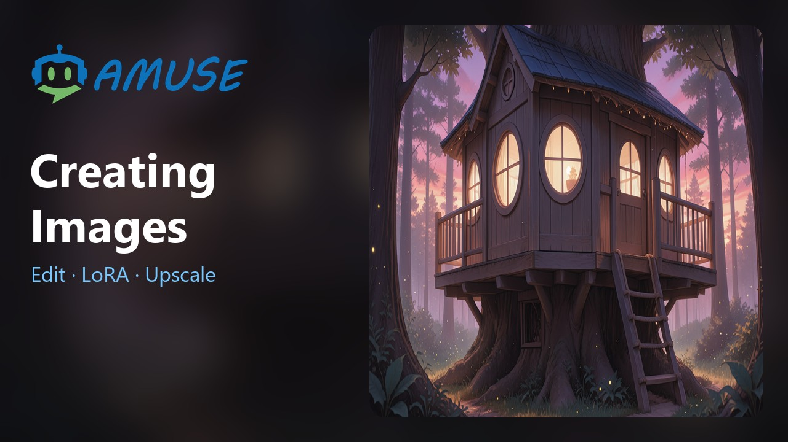
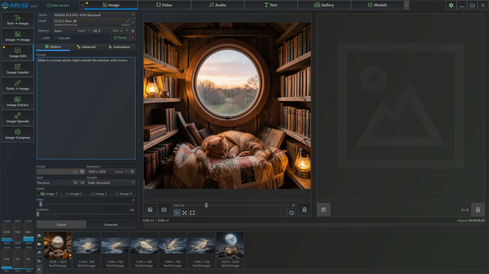
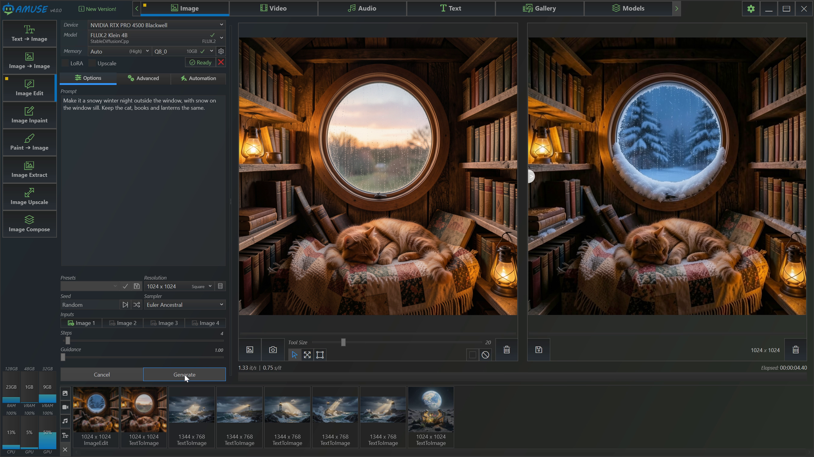

# Image Edit and other image tools

[](https://youtu.be/VLkXDETr0EE)

*Video: Creating images in Amuse (Image Edit starts at 2:03).*

**Image Edit** changes an existing image from a written instruction, such as "make it winter" or "add a hat to the dog". The rest of the image stays the same. This page also introduces the other tools in the **Image** section that start from an existing picture.

**Before you start:** load a model that supports editing. **FLUX.2 Klein 4B** supports Text to Image, Image Edit and Inpaint, so one download covers all three.

---

## 1. Open Image Edit and load the model

1. Click **Image** at the top, then **Image Edit** on the left.
2. Choose the **Device** and **Model**, and click **Load**. If the same model is already loaded in another image view, loading takes a moment.

## 2. Add an image

Drag an image from your **history** along the bottom of the window onto the input pane on the left. You can also:

- click the picture button under the pane to open a file,
- drop an image file from Windows Explorer,
- right-click the pane and choose **Paste**.



If the image isn't the same size as the **Resolution** setting, the **Crop Image** dialog opens so you can choose which part to use.

The tools under the input pane:

| Tool | What it does |
|---|---|
| **Mouse Mode** | Normal pointer. |
| **Move/Resize Mode** | Move and scale the image inside the canvas. Any area left uncovered is filled with bright green, which the model can then fill in (a simple way to extend an image). |
| **Select Mode** | Draw a red box to point the model at one area. The box is part of the image the model sees, so mention it in your instruction, for example "replace the object in the red box with a vase of flowers". **Tool Size** sets the line thickness. |

## 3. Describe the change

Write an instruction in the **Prompt** box. Say what should change *and* what should stay the same:

```
Make it a snowy winter night outside the window, with snow on the window sill.
Keep the cat, books and lanterns the same.
```

**Inputs** (**Image 1** to **Image 4**) lets supported models use up to four reference images at once, for example "put the jacket from Image 2 on the person in Image 1". Each input you switch on gets its own pane.

## 4. Generate and compare

Click **Generate**. When the result appears, drag the **< >** handle across it to compare the result with the original.



The result is added to your history, so you can drag it straight back in and keep editing.

---

## Other image tools

All of these are in the **Image** section on the left, and use the same model panel, options and history as Text to Image.

| Tool | What it does |
|---|---|
| **Image → Image** | Restyles an input image. **Strength** sets how much it changes (low keeps the original, high follows the prompt). Supported models can also use a **ControlNet** and an **Extractor**, for example to keep the pose or depth of the original. |
| **Image Inpaint** | Repaints only the area you paint over with the mask brush. Use **Draw** and **Erase** to edit the mask and **Strength** to set how much it changes. |
| **Paint → Image** | Draw a rough sketch with brushes and colours, and the model turns it into a finished picture. **Live Generation** updates the result as you paint. |
| **Image Extract** | Turns an image into a depth map, edges, a pose skeleton or a cut-out (see [Extractors](../tools/extract.md)). |
| **Image Upscale** | Enlarges an existing image (see [Upscaling images and video](../tools/upscale.md)). |
| **Image Compose** | Arrange images and text in layers, without AI. |

## Tips

- Short, direct instructions work best: "make it night", "change the car to red".
- To keep editing the same picture, drag each new result from history back onto the input.
- Use **Seed Batch** on the **Automation** tab to try several versions of the same edit.

---

**Related:** [Text to Image](text-to-image.md) · [LoRA and inline upscale](lora-and-upscale.md)
