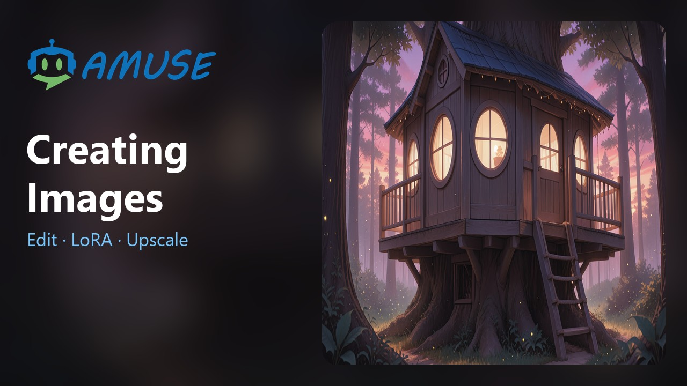
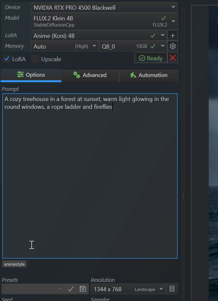
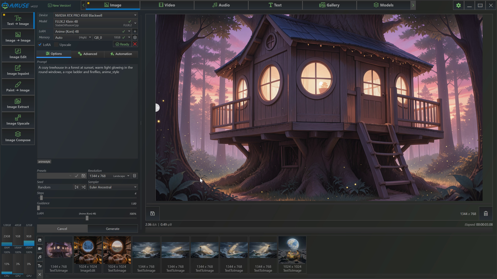
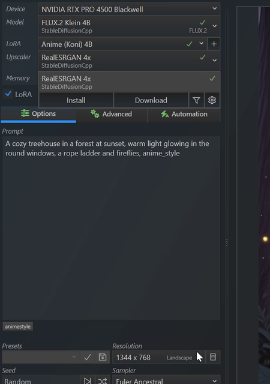
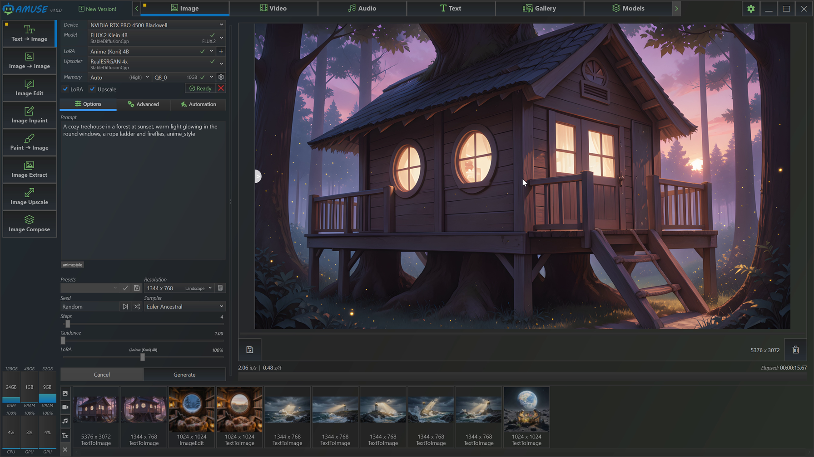

# LoRA and inline upscale

*Video: Creating images in Amuse (LoRA starts at 2:49, upscaling at 3:35).*

A **LoRA** (Low-Rank Adapter) is a small add-on file that teaches a model a style, a character or a concept. **Inline upscale** enlarges every image as soon as it's generated. Both are switched on in the model panel of Text to Image, Image to Image, Image Edit and Inpaint.

---

## LoRA adapters

### Get a LoRA

LoRAs are downloaded from the **Models** page, just like models. Set **Model Type** to **Lora Adapters** (or search by name) and click **Download**. Each LoRA works with one model family; the examples here use LoRAs made for **FLUX.2 Klein 4B**, such as **Anime (Koni) 4B**.

You can also add your own `.safetensors` LoRA files: open the LoRA list in the model panel and click **Install**.

### Use a LoRA

1. Tick **LoRA** under the model. A **LoRA** row appears in the model panel, listing only the LoRAs that match the selected model.
2. Pick a LoRA from the list. The **+** button adds another row so you can combine several LoRAs (up to seven); **✕** removes a row.
3. Click **Load**. LoRA changes always need another **Load**.

### Trigger words and strength

- Some LoRAs only take effect when a *trigger word* is in the prompt. Amuse shows each trigger word as a small button under the prompt; click it to add the word to the end of your prompt. (For Anime (Koni) 4B the trigger word is `anime_style`.)
- A **LoRA** slider for each loaded LoRA appears on the **Options** tab, from 1% to 200%. 100% is the strength the LoRA was made for. Lower it to blend the style in more gently.

---

## Inline upscale

### Get an upscaler

Upscale models are also on the **Models** page (**Model Type**: **Upscalers**). Good choices:

| Upscaler | Scale | Good for |
|---|---|---|
| **RealESRGAN 4x** | 4× | Photos and general images. Fast. |
| **AnimeSharp** models | 2× or 4× | Illustrations, anime and line art. |
| **SeedVR2** models | 2× to 4× | Highest quality restoration for images and video; slower and needs more memory. |

### Upscale as you generate

1. Tick **Upscale** under the model. An **Upscaler** row appears.
2. Open the list and choose an upscaler. The filter button at the bottom of the list shows only the upscalers you have installed.
3. Click **Load**.

From now on every image is upscaled automatically after it's generated; the progress strip shows "Upscaling Image...". The final size appears at the bottom right of the image. With RealESRGAN 4x, a 1344 × 768 image becomes 5376 × 3072.

Tiling options for the upscaler (**Enable Tiling**, **Tile Size** and **Tile Overlap**) are on the **Advanced** tab under **Upscale Options**. Tiling uses less memory for very large images.

> To upscale an image you've already made, use **Image → Image Upscale** instead (see [Upscaling images and video](../tools/upscale.md)).

---

## Tips

- Combine a LoRA with a fixed seed and change only the LoRA strength to see exactly what it adds.
- Upscaling takes longer than generating with fast models, so leave it off while you're trying out prompts, and switch it on for the final image.

## Troubleshooting

| Problem | Try this |
|---|---|
| The LoRA list says "No models found." | No installed LoRA matches the selected model. Download one made for that model family. |
| The LoRA has no visible effect | Add its trigger word, raise the LoRA slider, and check that you clicked **Load** after choosing it. |
| Out of memory while upscaling | Turn on **Enable Tiling** on the Advanced tab, or use a 2× upscaler. |

---

**Related:** [Text to Image](text-to-image.md) · [Image Edit and other image tools](image-edit.md)
