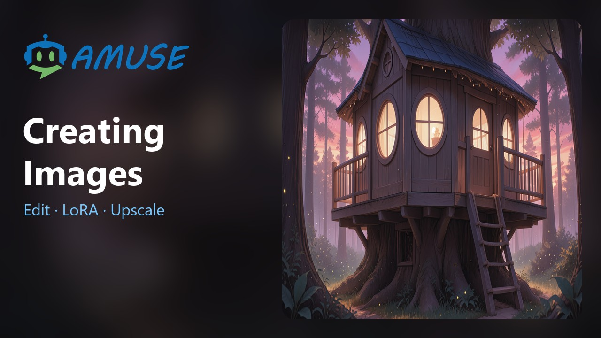
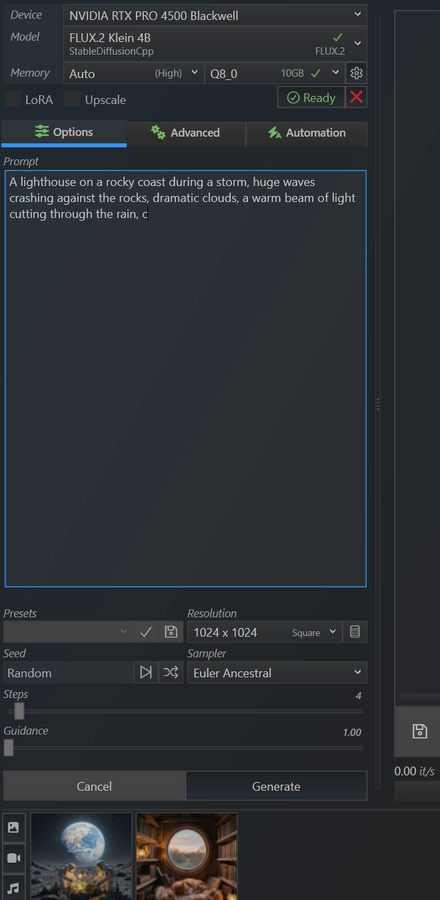
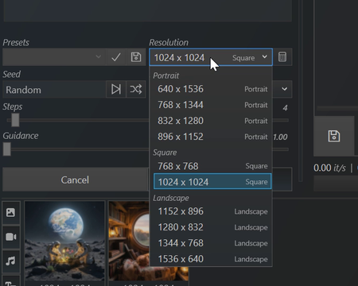
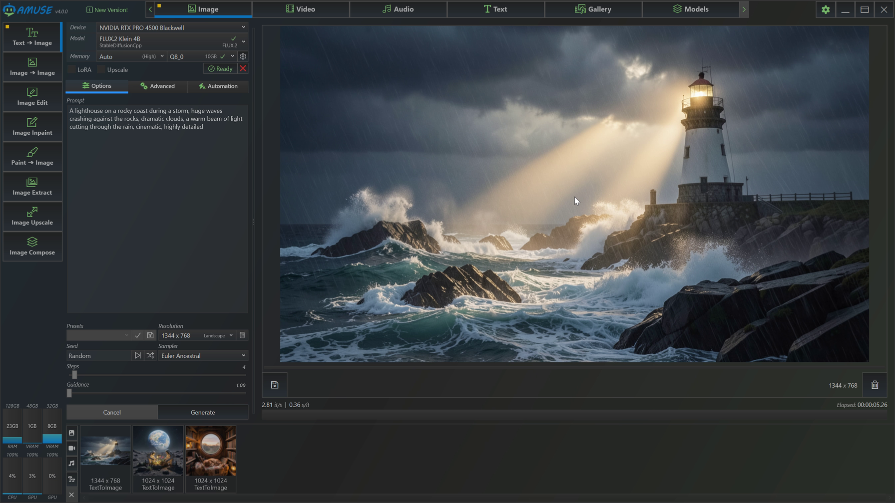
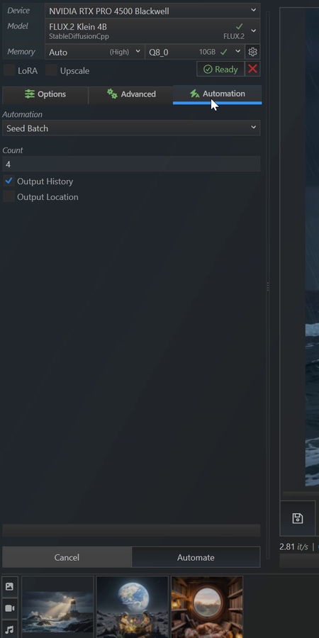
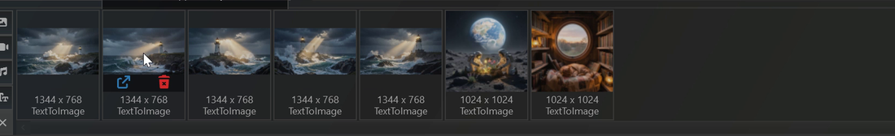

# Text to Image

[](https://youtu.be/VLkXDETr0EE)

*Video: Creating images in Amuse (Text to Image starts at 0:18, batches at 1:29).*

**Text to Image** creates a picture from a written description, called a *prompt*. This page covers every option in the view and how to make a batch of images in one go.

**Before you start:** download an image model from the **Models** page. The examples use **FLUX.2 Klein 4B**, a fast model that needs about 10 GB of memory (see [Your first image](../getting-started/your-first-image.md)).

---

## 1. Load a model

1. Click **Image** at the top of the window, then **Text → Image** on the left.
2. Choose the **Device** (graphics card) to run on, pick a **Model**, and click **Load**.
3. When the button changes to a green **Ready**, the model is loaded and the options below are enabled.



| Control | What it does |
|---|---|
| **Device** | The graphics card (or CPU) that runs the model. Graphics cards you have switched off in Settings are not listed. |
| **Model** | The model to use. Installed models have a tick. The list footer has **Install** (add your own model files), **Download** (open the Models page), a filter button (installed models only) and a gear (model settings). |
| **Memory** | How the model uses video memory. **Auto** picks a mode for your card; **Low**, **Balanced**, **Medium** and **High** trade speed for memory. The second box picks the downloaded quality (for example Q8_0). |
| **LoRA** / **Upscale** | Add a LoRA adapter or an upscaler to the pipeline (see [LoRA and inline upscale](lora-and-upscale.md)). |
| **Load** / **Ready** / **✕** | Loads the model. Changing anything above turns **Ready** back into **Load**. The red **✕** unloads the model to free memory. |

## 2. Write a prompt

Type what you want to see in the **Prompt** box. Describe the subject, the setting, the lighting and the style, for example:

```
A lighthouse on a rocky coast during a storm, huge waves crashing against the rocks,
dramatic clouds, a warm beam of light cutting through the rain, cinematic, highly detailed
```

You can drag text files or text from other apps into the prompt box. When **Guidance** is above 1, a **Negative Prompt** box appears below it for things you *don't* want in the image.

## 3. Options



| Option | What it does |
|---|---|
| **Resolution** | The size and shape of the image. The list has the model's recommended **Portrait**, **Square** and **Landscape** sizes. The calculator button beside it switches to **Width** and **Height** boxes so you can type any size. |
| **Seed** | Controls the randomness. **Random** (0) gives a new image every time. Type a number to repeat an image exactly. The first button picks a new random seed and keeps it; the second sets it back to Random. |
| **Sampler** | The method used to remove noise at each step. Each model lists the samplers that suit it; the default is usually best. |
| **Steps** | How many refinement steps to run. More steps can add detail but take longer. Distilled models such as FLUX.2 Klein need only about 4. |
| **Guidance** | How closely the image follows the prompt. Distilled models use 1; base models often use 3 to 7. |
| **Presets** | Reserved for saved option sets. |

Every model starts with its recommended **Steps**, **Guidance**, **Sampler** and **Resolution**, so in most cases you only need to write a prompt.

## 4. Generate

Click **Generate**. The preview updates as each step runs, and the strip under the image shows the speed (it/s), the elapsed time and progress. **Cancel** stops the current image.



The finished image appears in the output pane and is saved to your **history** along the bottom of the window. The size of the image is shown at the bottom right. The disk button saves a copy anywhere you like, and right-clicking the image offers **Copy** and **Save**.

---

## 5. Make a batch (Automation)

The **Automation** tab runs the same settings several times in a row. When it is selected, **Generate** becomes **Automate**.



| Automation | What it does |
|---|---|
| **Seed Batch** | Makes **Count** images, each with a different seed. With a fixed seed, the first image uses it and the rest follow on from it. |
| **Prompt Lines** | Choose a `.txt` file. Each line becomes one image, with the line placed in front of the main prompt. |
| **Prompt Files** | Choose a folder of `.txt` files. Each file becomes one image. |
| **Output History** | Adds each result to history (on by default). |
| **Output Location** | Also saves each image as a PNG in the **Output Folder** you choose. |

Every image in the batch is added to your history, so you can compare them and keep your favourites.



---

## Tips

- Keep the seed fixed while you adjust the prompt, so you can see exactly what each change does.
- Long, specific prompts work better than short ones with modern models such as FLUX.2.
- If you run out of video memory, set **Memory** to **Low** or choose a smaller quality such as Q4_0.

## Troubleshooting

| Problem | Try this |
|---|---|
| **Generate** is greyed out | Load the model first. Anything you change in the model panel needs another **Load**. |
| "Model Load Failed" | Check that the backend for your card shows **Ready** on the Home page, then try **Memory: Low**. |
| The image ignores part of the prompt | Put the most important things first, and describe them in more detail. |

---

**Related:** [Image Edit and other image tools](image-edit.md) · [LoRA and inline upscale](lora-and-upscale.md) · [Your first image](../getting-started/your-first-image.md)
