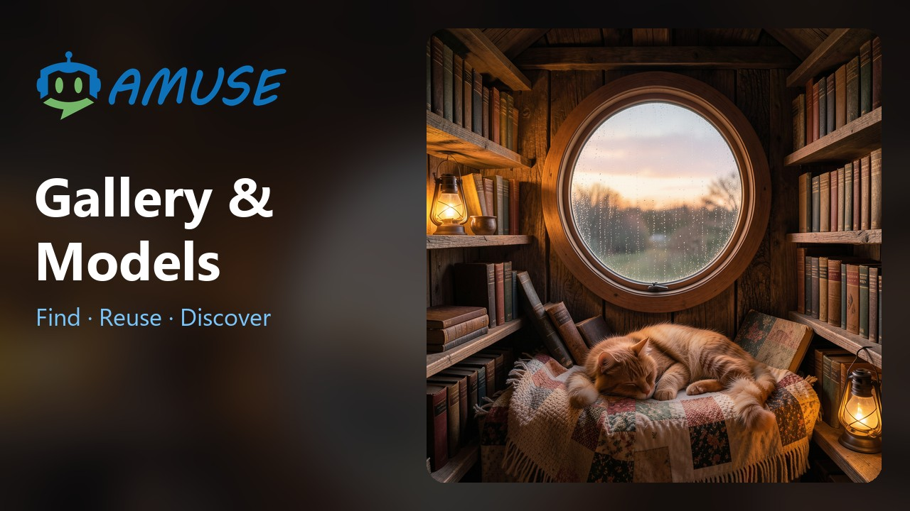
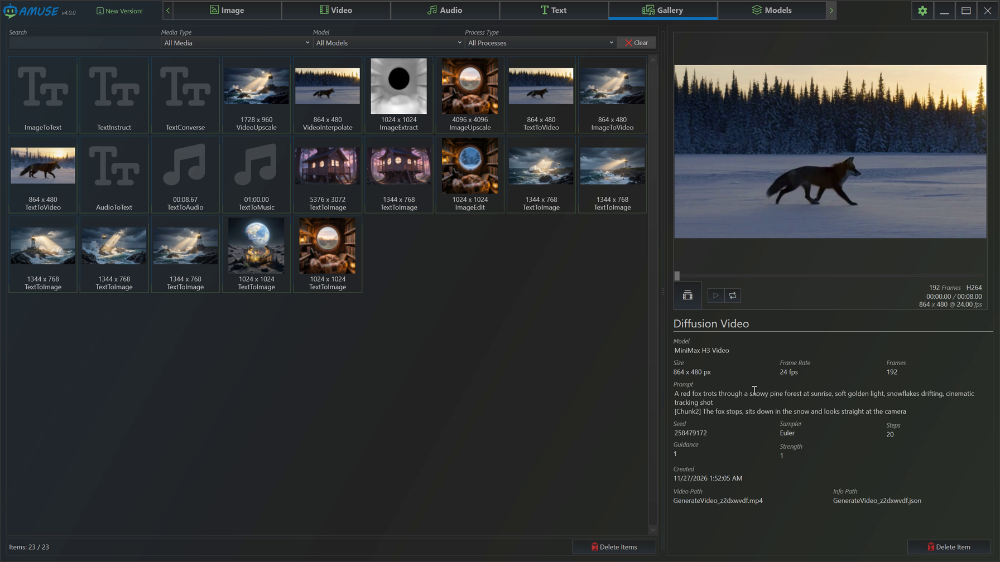
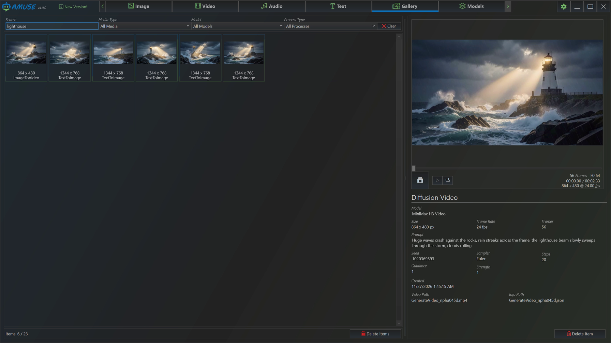
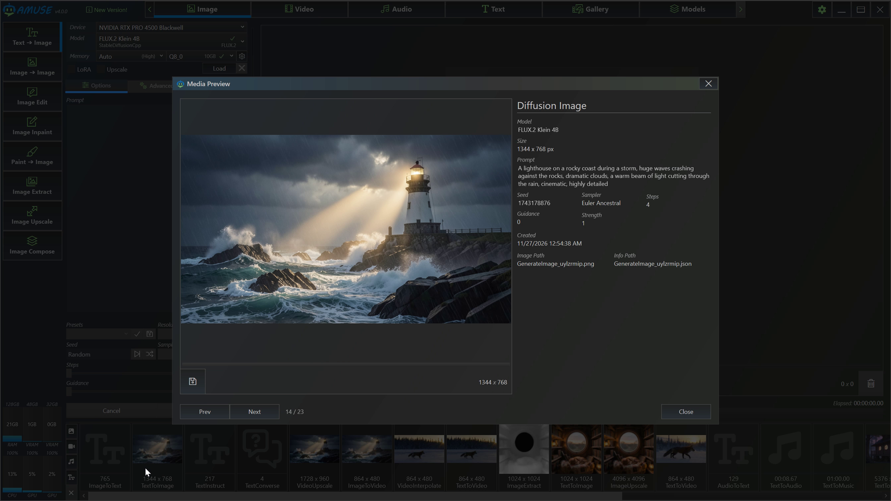

# Gallery, history and drag and drop

*Video: Gallery, history and models (the Gallery starts at 0:15, the history strip at 1:17).*

Everything you make in Amuse is saved automatically: every image, video, song, speech clip, transcript and conversation. You can find it again in two places: the **Gallery**, and the **history strip** in every tool.

---

## The Gallery

Click **Gallery** at the top of the window. Your work is shown newest first.

Click an item to see it on the right, with everything needed to make it again:

- the **model**, LoRA and ControlNet used,
- the **prompt** and negative prompt,
- the **seed**, sampler, steps, guidance and strength,
- the size (and frame rate, frames or duration for video and audio),
- upscale and extract settings, if used,
- when it was made, and links to the **file** and its settings file. Click the file name to open the folder that contains it.

### Filters and search

| Filter | Shows |
|---|---|
| **Search** | Items whose prompt contains the words you type. |
| **Media Type** | Images, videos, audio or text. |
| **Model** | Items made with one model. |
| **Process Type** | Items made with one tool, for example TextToImage or ImageToVideo. |

Filters combine, so you can show, for example, only videos made with MiniMax H3. The red **✕** clears them all. The bottom left shows how many items match.

### Deleting

- **Delete Item** (bottom right) deletes the selected item and its file straight away.
- **Delete Items** (bottom left) deletes *every item currently shown*, so filter first to delete a group. Amuse asks you to confirm.

---

## The history strip

Under every Image, Video, Audio and Text tool there's a strip of your recent work (in Converse and Instruct it's down the right-hand side). It also includes files you've opened in a tool, so they're easy to reuse.

| Action | What it does |
|---|---|
| Filter buttons (left) | Show only images, videos, audio or text. **✕** clears the filter. |
| Hover | Shows the tool, size, model and file path. |
| **Preview** (blue button on hover) | Opens the item larger. **Prev** / **Next** (or the arrow keys) step through your history. |
| **Remove** (red button on hover) | Deletes the item at once. Files you opened from your own folders are never deleted, only removed from the strip. |
| Drag | Drag the item into another tool (see below). |

In **Settings → General → History** you can set how many items to keep, put the strip down the right-hand side, and choose whether opened files are added to it.

---

## Drag and drop

Almost everything in Amuse can be dragged:

| Drag from | Drop onto | For example |
|---|---|---|
| History (image) | Any image input | Image Edit, Image to Video, Image Upscale, Image Extract, Image to Text |
| History (video) | Any video input | Video Upscale, Video Interpolate, Video Extract, Video to Video |
| History (audio) | Any audio input | Audio to Text, Audio to Music, Voice Clone, reference audio |
| History (text) | A prompt box, or Context in Converse and Instruct | Use a transcript as context |
| History (conversation) | The Converse conversation | Carry on a past conversation |
| File Explorer | Any matching input | Images, videos, audio and `.txt` / `.md` files |
| History | File Explorer or another app | Copy the file out of Amuse |

When you drag something, the inputs that accept it are highlighted. If an image isn't the size the tool needs, the **Crop Image** dialog opens so you can choose which part to use.

---

**Related:** [The Models page](../models/models-page.md) · [Your first image](../getting-started/your-first-image.md)
