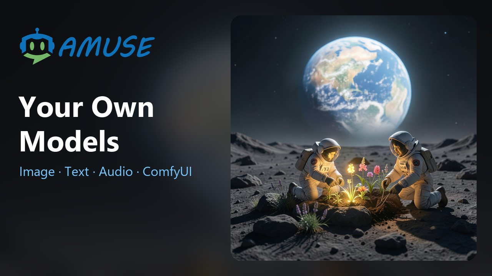
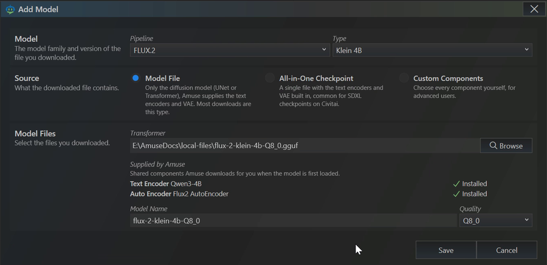
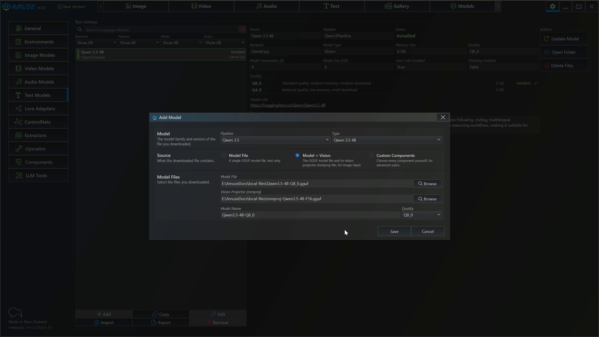
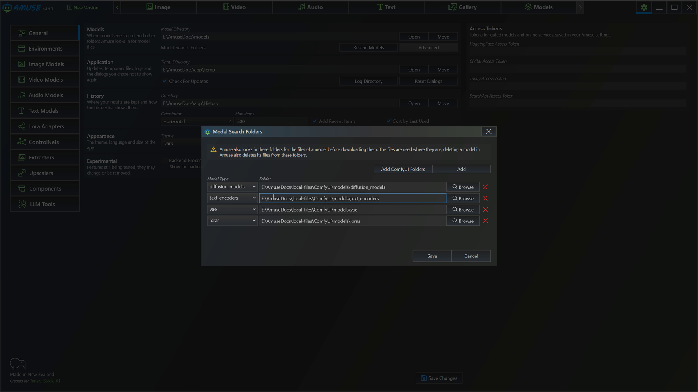

# Installing your own models

*Video: Installing your own models.*

The [Models page](models-page.md) downloads models for you, but you can also use model files you already have: from Hugging Face, Civitai, ComfyUI or anywhere else. Amuse supports **GGUF** and **Safetensors** files for image, video and audio models, **GGUF** for language models, and **ONNX** for some upscalers and extractors.

Models are added from **Settings** (the gear at the top right) or with the **Install** button at the bottom of any model list in a tool.

---

## Image and video models

1. Open **Settings → Image Models** (or **Video Models**) and click **Add**.
2. **Model**: tell Amuse what the file is. Choose the model family in **Pipeline** (for example FLUX.2, Wan Video, StableDiffusion XL) and the version in **Type** (for example Klein 4B).
3. **Source**: what your file contains.

   | Source | Choose it when |
   |---|---|
   | **Model File** | Your file is only the main model (the UNet or Transformer). This is most downloads. Amuse supplies the text encoders and VAE: they're listed under **Supplied by Amuse** as **Installed** or **Will download**. |
   | **All-in-One Checkpoint** | Your file has the text encoders and VAE built in, common for SDXL checkpoints on Civitai. |
   | **Custom Components** | You want to choose every part yourself (for advanced users). Each part can be a local file or folder, a shared component, or a download link. |

4. **Model Files**: click **Browse** and choose your file. Amuse fills in the **Model Name** and **Quality** from the file name (for example Q8_0). Change the name to something you'll recognise.
5. Click **Save**. If any shared parts still need downloading, Amuse asks whether to download them now.

The model appears in the list and in every tool that can use it.

## Language models

1. Open **Settings → Text Models** and click **Add**.
2. Choose the **Pipeline** (Gemma 4, Qwen 3.0, Qwen 3.5, Qwen 3.6 or Qwen 3.8) and the size in **Type**.
3. Choose the **Source**:
   - **Model File**: a single GGUF file, text only.
   - **Model + Vision**: the GGUF file and its *vision projector* (the `mmproj` file), so the model can see images in Converse, Instruct and Image to Text.
4. **Browse** to the file(s), check the name and quality, and click **Save**.

## Audio models

Music, speech and transcription models are added from **Settings → Audio Models → Add**. Choose the family (for example ACE-Step, Stable Audio, Supertonic, Parakeet), browse to the GGUF file, and save.

## LoRA, ControlNet, upscalers and extractors

Each has its own page in Settings with an **Add** button: **Lora Adapters**, **ControlNets**, **Upscalers** and **Extractors**. Choose the model family, then either a **Downloaded File** or a **Download Link** (on Hugging Face, copy the link of the file's download button). For LoRAs you can add **Trigger Words**, which then appear as buttons under the prompt.

---

## Use your ComfyUI models (Model Search Folders)

If you already have models in ComfyUI or another app, Amuse can use them where they are, without copying or downloading them again.

1. Open **Settings → General**. Next to **Model Search Folders**, click **Advanced**.
2. Click **Add ComfyUI Folders** and choose your ComfyUI folder. Amuse finds its `diffusion_models`, `checkpoints`, `text_encoders`, `clip`, `vae`, `loras`, `controlnet` and `upscale_models` folders. Or click **Add** to add any folder and choose its type.
3. Click **Save**, then **Save Changes**.

From then on, when a model is downloaded, Amuse looks in these folders first and uses any matching files in place. **Rescan Models** (next to Advanced) checks the folders again.

> Deleting a model's files in Amuse also deletes them from a search folder, because the files are used where they are.

---

## Managing your models

On each Settings model page, select a model to see its details and use:

| Button | What it does |
|---|---|
| **Copy** | Make a copy to change its settings. |
| **Edit** | Change the name, default steps and guidance, resolutions, supported tools and files (your own models). |
| **Import** / **Export** | Share model settings as a JSON file. |
| **Remove** | Remove the model from Amuse. Its files are kept. |
| **Open Folder** | Open the folder that holds the model's files. |
| **Delete Files** | Delete the model's downloaded files. |
| **Update Model** / **Download Model** / **Retry Download** | Download or update the model's files. |

---

## Troubleshooting

| Problem | Try this |
|---|---|
| "Quality must be selected" | Choose the quality that matches your file (for example Q8_0, Q4_K or BFloat16). |
| "Model file not found" | Check the file still exists, and isn't on a disconnected drive. |
| The model fails to load | Make sure the **Pipeline** and **Type** match the file. A FLUX.1 file won't load as FLUX.2. |
| The model can't see images | Add it again with **Model + Vision** and its `mmproj` file. |

---

**Related:** [The Models page](models-page.md) · [First run](../getting-started/first-run.md)
