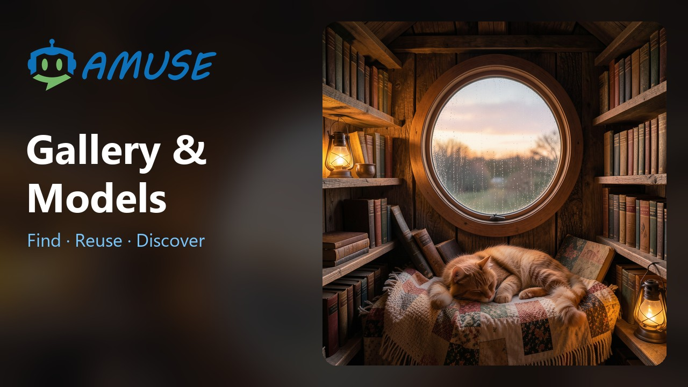
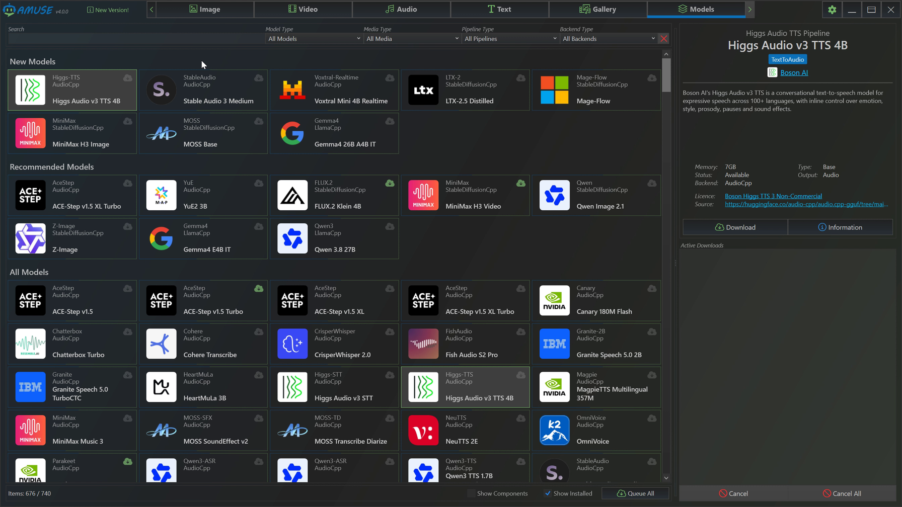
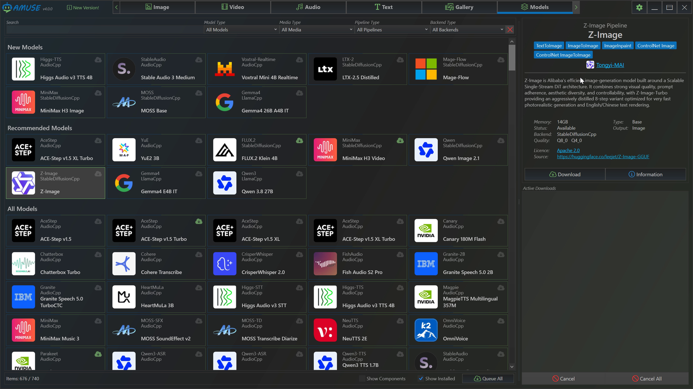

# The Models page

*Video: Gallery, history and models (the Models page starts at 1:57). Downloading a model is shown in [Getting started](../getting-started/your-first-image.md).*

The **Models** page lists every model Amuse supports, ready to download with one click: image, video, audio and language models, plus LoRA adapters, ControlNets, upscalers and extractors.

---

## Browse

Click **Models** at the top of the window. **New Models** and **Recommended Models** are at the top, followed by **All Models**. Each tile shows the model's publisher, the backend that runs it, and a cloud icon (green when it's installed).

## Model details

Select a model to see it in the panel on the right:

| Detail | What it tells you |
|---|---|
| Pipeline and tasks | The model family and what it can do, for example TextToImage, ImageEdit or ImageToVideo. |
| Publisher | Who made the model (links to their site). |
| Description | What the model is good at. |
| **Memory** | About how much graphics memory it needs. |
| **Status** | Available, Download Queued, Downloading, Download Failed, Installed, or Unknown (an update is available: the Download button reads **Update**). |
| **Backend** | StableDiffusion.cpp, Audio.cpp, Llama.cpp or ONNX Runtime. That backend must be installed for your card. |
| **Type** / **Output** | Base, Distilled or Turbo, and the kind of media it makes. |
| **Licence** / **Source** | The model's licence, and where it's downloaded from. |

**Download** asks which quality to download (for example Q8_0 or Q4_0; smaller files use less memory), then adds it to **Active Downloads**. Anything the model needs, such as its text encoder, is downloaded with it. **Information** shows the files that make up each quality of the model, and where they come from.

> There's no delete button on the Models page. To remove a model and its files, use the model pages in **Settings**.

## Filters

| Filter | Use it to |
|---|---|
| **Search** | Find models by name. |
| **Model Type** | Show only Diffusion (image and video) models, ControlNets, Lora Adapters, Upscalers, Extractors, Components or LLMs. |
| **Media Type** | Show only image, video, audio or text models. |
| **Pipeline Type** | Show one model family, for example FLUX.2 or Wan. |
| **Backend Type** | Show only models for one backend. |
| **Show Installed** | Untick to hide models you already have. |
| **Show Components** | Tick to include shared parts such as text encoders and VAEs. |

The red **✕** clears the filters. The bottom left shows how many models match.

## Downloads

**Active Downloads** (bottom right) shows each download's progress, speed and time remaining. Downloads carry on in the background while you use the rest of Amuse.

| Button | What it does |
|---|---|
| **Cancel** / **Retry** | Stops the selected download; for a failed download, **Retry** tries again. |
| **Cancel All** | Stops all downloads. |
| **Queue All** | Queues every model in the current (filtered) list that isn't installed, after asking you to confirm. Filter first! |

> Some models need you to accept a licence on their website, or an access token. Add tokens for Hugging Face and Civitai in **Settings → General → Access Tokens**.

---

**Related:** [Your first image](../getting-started/your-first-image.md) · [Gallery, history and drag and drop](../library/gallery-and-history.md)
