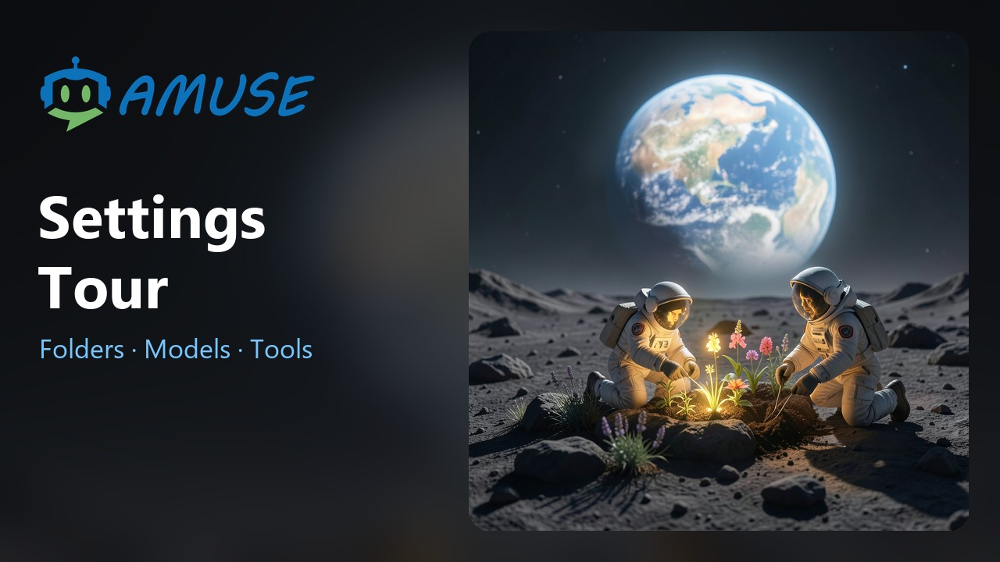
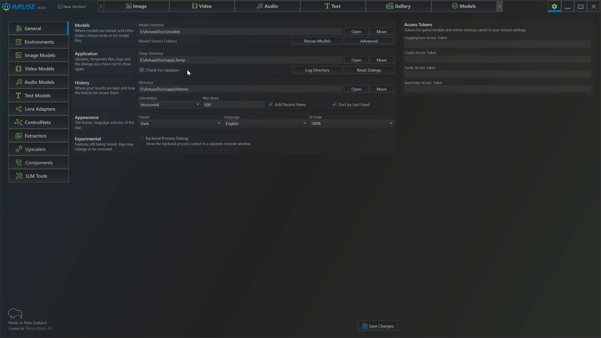
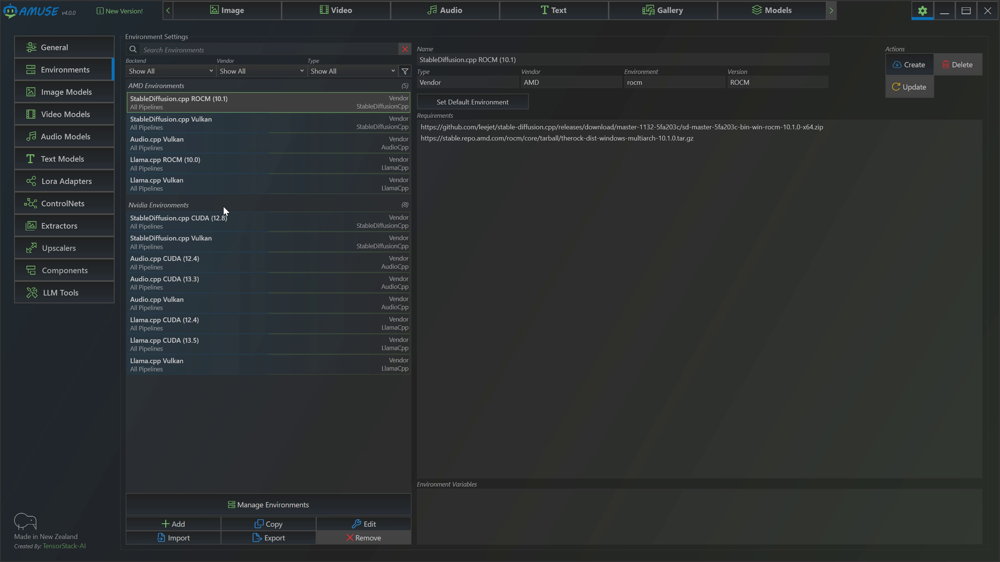
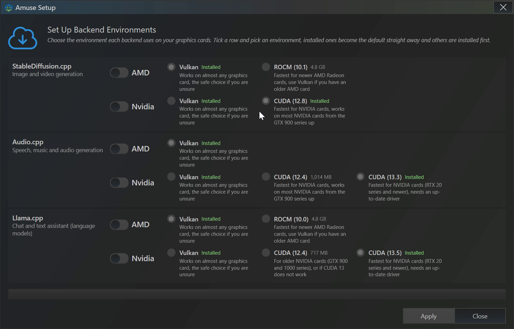
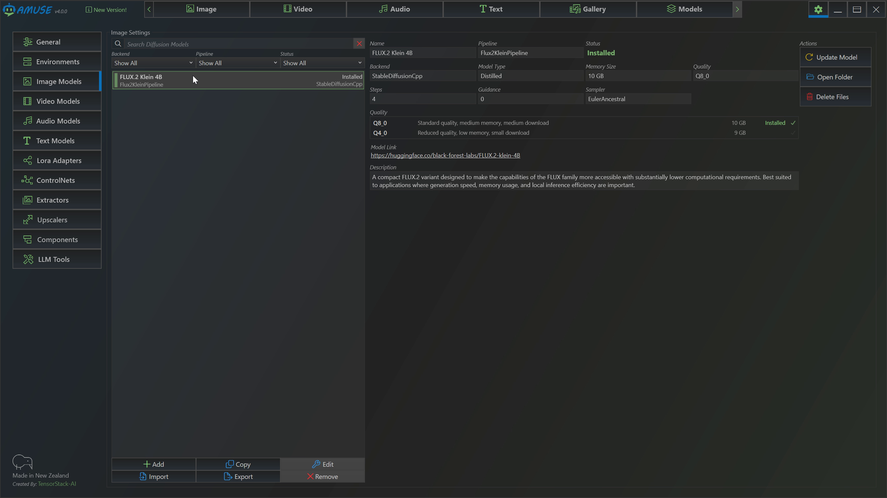
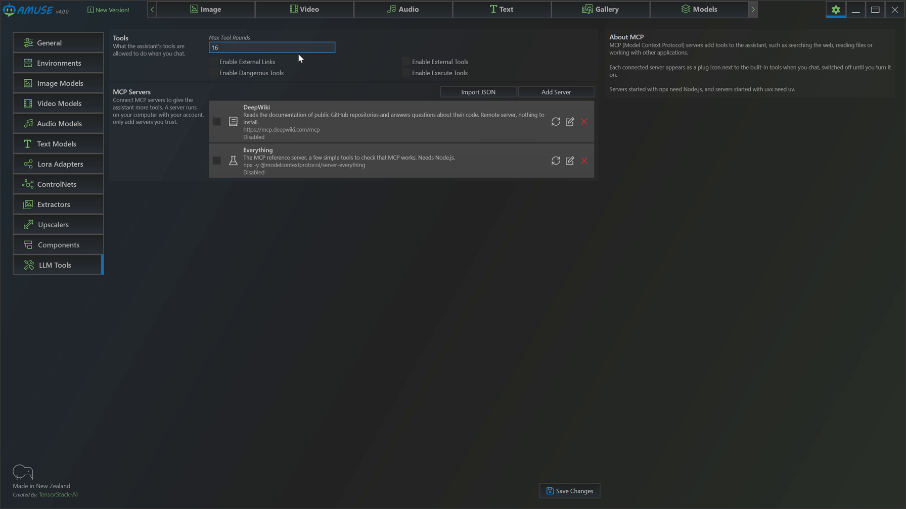

# Settings

*Video: A tour of Settings.*

Click the **gear** at the top right of the window to open Settings. The pages are listed on the left.

> Changes on the **General** page take effect when you click **Save Changes** at the bottom.

---

## General

### Models

| Setting | What it does |
|---|---|
| **Model Directory** | Where downloaded models are stored. **Open** opens the folder; **Move** moves all your models to another folder or drive. |
| **Model Search Folders** | **Advanced** adds other folders, such as ComfyUI's, that Amuse checks for a model's files before downloading (see [Installing your own models](models/local-models.md#use-your-comfyui-models-model-search-folders)). **Rescan Models** checks all folders again. |

### Application

| Setting | What it does |
|---|---|
| **Temp Directory** | Where temporary files go while Amuse works. **Move** moves it to another drive. |
| **Check For Updates** | Checks for a new version each time Amuse starts. A **New Version!** link appears at the top of the window when one is available. |
| **Log Directory** | Opens the folder with Amuse's log files, useful when reporting a problem. |
| **Reset Dialogs** | Brings back every message you told Amuse not to show again, including the tool permission prompts. |

### History

| Setting | What it does |
|---|---|
| **Directory** | Where your results are saved. **Move** moves them to another folder or drive. |
| **Orientation** | Shows the history strip along the bottom (**Horizontal**) or down the right-hand side (**Vertical**). |
| **Max Items** | How many items the history strip shows. |
| **Add Recent Items** | Also lists files you open in a tool, so they're easy to reuse. |
| **Sort by Last Used** | Moves an item to the front of the strip when you use it again. |

### Appearance

| Setting | What it does |
|---|---|
| **Theme** | **Dark** or **Light**. |
| **Language** | English, Japanese, Chinese, Korean, German, French, Spanish, Portuguese or Russian. |
| **UI Scale** | The size of the interface, from 50% to 300%. |

### Access Tokens

Some models need you to sign in and accept a licence before you can download them. Create an access token on the site and paste it here:

| Token | Used for |
|---|---|
| **HuggingFace Access Token** | Gated models on Hugging Face. |
| **Civitai Access Token** | Models on Civitai that need an account. |
| **Tavily Access Token** / **SearchApi Access Token** | Better results from the **Web Search** and **Web Page** tools (without a token, Web Search uses DuckDuckGo). |

Tokens are saved in your Amuse settings on your PC.

### Experimental

**Backend Process Debug** shows each backend's output in a separate console window, for troubleshooting.

---

## Environments

**Environments** are the backends (StableDiffusion.cpp, Audio.cpp and Llama.cpp) installed for each graphics card, in versions such as CUDA, ROCm and Vulkan.

- Select an environment to see its vendor, version and the files it uses.
- **Manage Environments** opens the setup window, where you can install, update or add backends for each card, as on first run (see [First run](getting-started/first-run.md#3-choose-your-backends)).

  
- **Set Default Environment** makes the selected environment the one used for its backend on that card.
- **Create**, **Update** and **Delete** (top right) install, update or remove the selected environment.

---

## Model pages

**Image Models**, **Video Models**, **Audio Models**, **Text Models**, **Lora Adapters**, **ControlNets**, **Extractors**, **Upscalers** and **Components** each list the models of that kind. Search and filter the list by backend, pipeline and status, and select a model to see its details.

| Button | What it does |
|---|---|
| **Update Model** / **Download Model** / **Retry Download** | Download or update the model's files. |
| **Open Folder** | Open the folder that holds the model's files. |
| **Delete Files** | Delete the model's files to free up space. The model stays in the list and can be downloaded again. |
| **Add** | Add a model from your own files (see [Installing your own models](models/local-models.md)). |
| **Copy** / **Edit** | Copy a model to change its settings, or edit a model you added. |
| **Import** / **Export** | Share model settings as JSON files. |
| **Remove** | Remove a model you added. Its files are kept. |

---

## LLM Tools

Controls what language models are allowed to do with [tool calls](text/tool-calls.md).

| Setting | What it does |
|---|---|
| **Max Tool Rounds** | How many times a model may call tools for one answer. |
| **Enable External Links** | Open links in answers without asking. |
| **Enable External Tools** | Allow tools that use online services without asking. |
| **Enable Dangerous Tools** | Allow tools that read files or run MCP tools without asking. |
| **Enable Execute Tools** | Allow starting programs and opening links without asking. |

**MCP Servers** adds tools from Model Context Protocol servers. **Add Server** connects a local command (such as `npx` or `uvx`) or a remote URL; **Import JSON** pastes a configuration from a server's instructions. Two examples are included and switched off: **DeepWiki** (reads GitHub repository documentation) and **Everything** (a test server, needs Node.js). Tick a server to connect it; its tools then appear as a plug icon in the tool grid.

---

**Related:** [First run](getting-started/first-run.md) · [Installing your own models](models/local-models.md) · [Tool calls](text/tool-calls.md)
