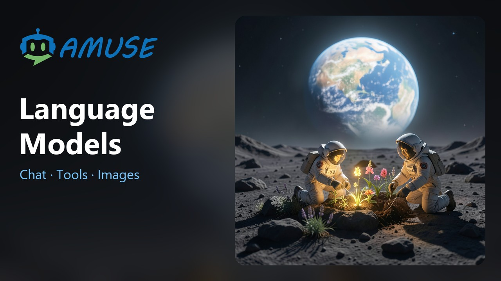
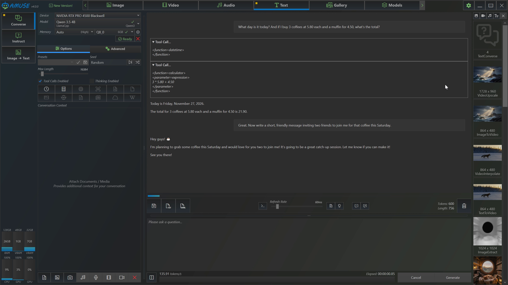
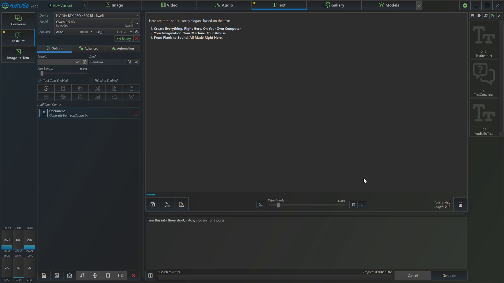
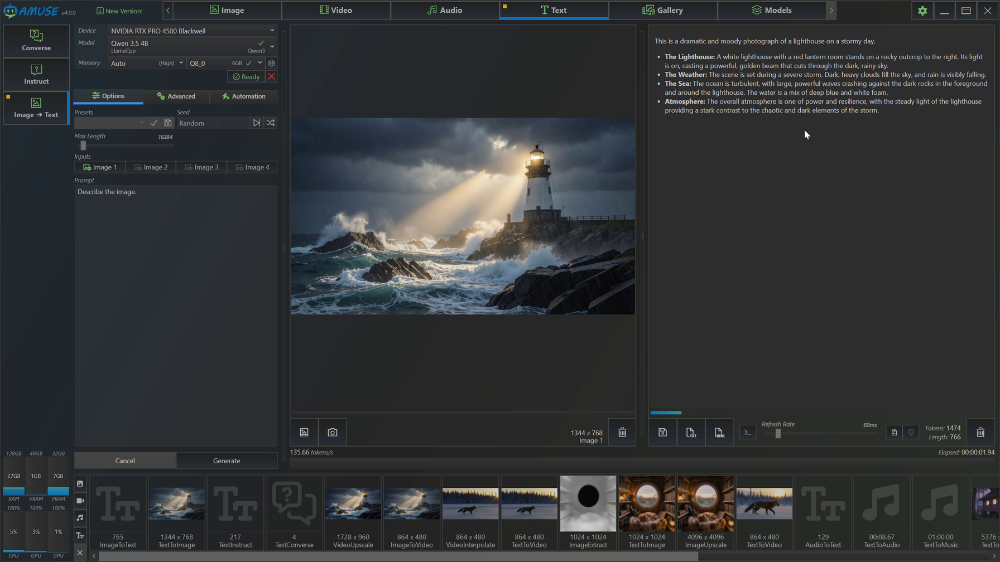

# Converse, Instruct and Image to Text

*Video: Language models in Amuse (Converse starts at 0:19, Instruct at 1:32, Image to Text at 2:25).*

Amuse runs language models, the kind of AI you chat with, entirely on your own PC. There are three ways to use them, all under the **Text** tab:

| View | Use it to |
|---|---|
| **Converse** | Have a conversation. The model remembers what was said, can use tools, and every conversation is saved to your history. |
| **Instruct** | Run a single task, such as summarising, rewriting or translating. Each task starts fresh. |
| **Image → Text** | Describe an image, or ask questions about up to four images. |

**Before you start:** download a language model from the **Models** page (**Model Type**: **LLMs**). Language models run on the **Llama.cpp** backend.

| Model | Memory | Notes |
|---|---|---|
| **Qwen 3.5 4B** | 4–6 GB | Small and fast; understands text and images. Used in the video. |
| **Gemma4 E2B / E4B IT** | 4–9 GB | Also accepts audio as context. |
| **Qwen 3.5 9B**, **Gemma4 12B IT** | 7–14 GB | Better answers, still fast on most cards. |
| **Qwen 3.6 / 3.8 27B**, **Gemma4 26B / 31B** | 16–35 GB | The most capable models. |

---

## Converse

1. Click **Text** at the top, then **Converse** on the left.
2. Choose the **Device** and **Model**, and click **Load**.
3. Type in the box at the bottom and press **Enter** (**Shift+Enter** adds a new line).

The answer streams in as it's written. Ask follow-up questions, and the model remembers the conversation. The buttons under the conversation:

| Button | What it does |
|---|---|
| **Save**, **Copy text**, **Copy HTML** | Save or copy the last response. |
| **Streaming** / **Refresh Rate** | Show the answer as it's written, and how often the view updates. |
| **Formatting** | Show headings, lists and tables, or plain text. |
| **Thinking** | Show or hide the model's reasoning when **Thinking Enabled** is on. |
| **Rewind** | Remove the last question and answer. |
| **Branch** | Start a copy of the conversation, keeping the original. |
| **Clear** (bin) | Start a new conversation. |

Every conversation is saved to your **history**. Drag it from history back onto the conversation to carry on later.

### Options

| Option | What it does |
|---|---|
| **Seed** | Random gives a different answer each time; a fixed number repeats it. |
| **Max Length** | The longest answer the model may write, in tokens. |
| **Tool Calls Enabled** | Lets the model use the tools you switch on below (see [Tool calls](tool-calls.md)). |
| **Thinking Enabled** | Lets models that support it reason step by step before answering. Slower, but better for hard questions. |
| **Conversation Context** | Documents, images or audio for the model to use (see [Context](#context-documents-images-and-audio)). |

The **Advanced** tab has the sampling settings (**Temperature**, **TopK**, **TopP**, **Repetition Penalty**, **Sampling Enabled**) and a **System Prompt**, which sets how the model should behave throughout the conversation, for example "You are a helpful travel guide. Keep answers short."

---

## Instruct

**Instruct** is for one task at a time. It looks like Converse, but each **Generate** starts fresh, so earlier answers don't affect the next one.

1. Click **Instruct** on the left and click **Load**.
2. Type what you want done, and click **Generate**.

The **Automation** tab runs the same instruction over many inputs: **Prompt Lines** (one task per line of a text file) or **Prompt Files** (one task per file in a folder), with results saved to history or a folder.

---

## Context: documents, images and audio

Give the model something to work from in **Conversation Context** (Converse) or **Additional Context** (Instruct):

- Drag a text item from your **history** onto the list (for example a transcript from **Audio → Text**), or a `.txt` or `.md` file from File Explorer.
- Or use the buttons under the list:

| Button | Adds |
|---|---|
| **Import Document** | Text, Markdown, JSON, CSV, PDF, Word (.docx) or RTF files. |
| **Import Image** / camera | Images, for models that can see (such as Qwen 3.5). |
| **Import Audio** / microphone | Audio, for models that can hear (Gemma4 E2B and E4B). |

The button with the red **✕** clears the list. In Converse, attachments are sent once and then locked for the rest of the conversation; in Instruct they're sent with every task.

> Documents are read as text. Scanned PDFs that contain only images have no text to read.

---

## Image to Text

1. Click **Image → Text** on the left and click **Load** (the model list shows only models that can see).
2. Drag an image from your history onto **Image 1**, or use the picture button.
3. The **Prompt** starts as "Describe the image." Change it to ask anything about the picture, then click **Generate**.

Turn on **Image 2** to **Image 4** under **Inputs** to compare or combine several images, for example "What's different between these two pictures?". The **Automation** tab describes every image in a folder.

> Image to Text is a quick way to write a prompt: describe an image you like, then use the description in **Text to Image**.

---

## Tips

- Small models are fast but can get facts wrong. Use tools, or give the model a document, when accuracy matters.
- If answers are cut off, raise **Max Length**.
- Only one language model is loaded at a time, but an image or video model can stay loaded alongside it if your card has the memory.

---

**Related:** [Tool calls](tool-calls.md) · [Speech to Text](../audio/speech-to-text.md)
