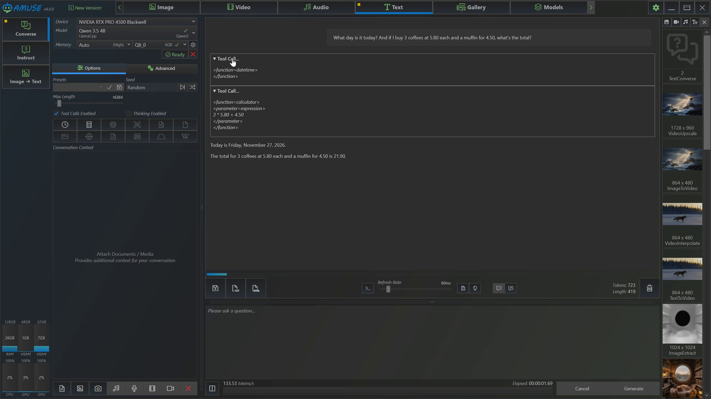

# Tool calls

*Video: Language models in Amuse (tool calls start at 0:36).*

Language models only know what they learned in training: they don't know today's date, can't do exact arithmetic reliably, and can't look things up. **Tools** fix that. When a tool is switched on, the model can ask Amuse to run it, read the result, and use it in its answer.

Tools work in **Converse** and **Instruct**, with models that support them (all the Qwen 3.5+ and Gemma4 models).

---

## Switch tools on

1. Load a model in **Converse** or **Instruct**.
2. Make sure **Tool Calls Enabled** is ticked.
3. Click the tools you want in the grid below it. Hover over an icon to see its name. **Date & Time** is on by default.

When the model uses a tool, a **Tool Call...** block appears in the conversation. Click it to see exactly what the model asked for.

## Built-in tools

| Tool | What it does | Asks permission |
|---|---|---|
| **Date & Time** | The current date, day, time and time zone. | No |
| **Calculator** | Exact arithmetic. | No |
| **System Info** | Your PC's operating system, CPU, memory, graphics cards and disk space. | No |
| **Screenshot** | Takes a screenshot and adds it to your history. | No |
| **File Search** | Finds files on your PC by name, type or content (Desktop, Documents, Downloads, Pictures, Videos and Music by default). | No |
| **File Read** | Reads a text, code, PDF or Word file. | Yes: **Dangerous Action** |
| **Application** | Starts an installed app, opens a link, file or folder, or shows a file in File Explorer. | Yes, for starting programs and opening links: **Dangerous Action** |
| **Web Search** | Searches the web (DuckDuckGo, or Tavily / SearchApi if you add an access token in **Settings → General**). | Yes: **External Access** |
| **Web Page** | Reads a web page. | Yes: **External Access** |
| **World News** | The latest headlines from Sky News, BBC News and the Guardian. | Yes: **External Access** |
| **Weather** | Current weather and a forecast for any place (Open-Meteo). | Yes: **External Access** |
| **Wikipedia** | Searches Wikipedia and returns article summaries. | Yes: **External Access** |

Web tools only connect to public internet addresses, never to devices on your local network.

## Permission prompts

The first time the model uses a tool that reaches the internet or could change your computer, Amuse asks first:

- **External Access**: the tool will send part of your question (such as a town name or a search) to an online service.
- **Dangerous Action**: the tool will read a file, start a program or open a link. The dialog shows exactly what it will do.

Click **Yes** to allow it or **No** to refuse; the model is told it was refused and carries on. Tick **Don't Ask Again** to remember your answer. You can change these later in **Settings → LLM Tools** (**Enable External Tools**, **Enable Dangerous Tools**, **Enable Execute Tools**), and **Settings → General → Reset Dialogs** brings the prompts back.

## More tools with MCP servers

**MCP** (Model Context Protocol) servers add more tools, such as reading GitHub documentation or working with other apps. Add them in **Settings → LLM Tools → MCP Servers**: click **Add Server** (a local command or a remote URL) or **Import JSON** to paste a configuration from a server's instructions. Each connected server appears as a plug icon in the tool grid, switched off until you turn it on.

> Only add MCP servers you trust: a local server runs on your computer with your account.

---

## Tips

- Switch on only the tools you need. Small models choose better from a short list.
- Ask for things the tool is good at: "what's 18% of 245?" gets an exact answer from the calculator.
- **Max Tool Rounds** (in Settings → LLM Tools) limits how many times the model may call tools for one answer.

---

**Related:** [Converse, Instruct and Image to Text](converse-and-instruct.md)
