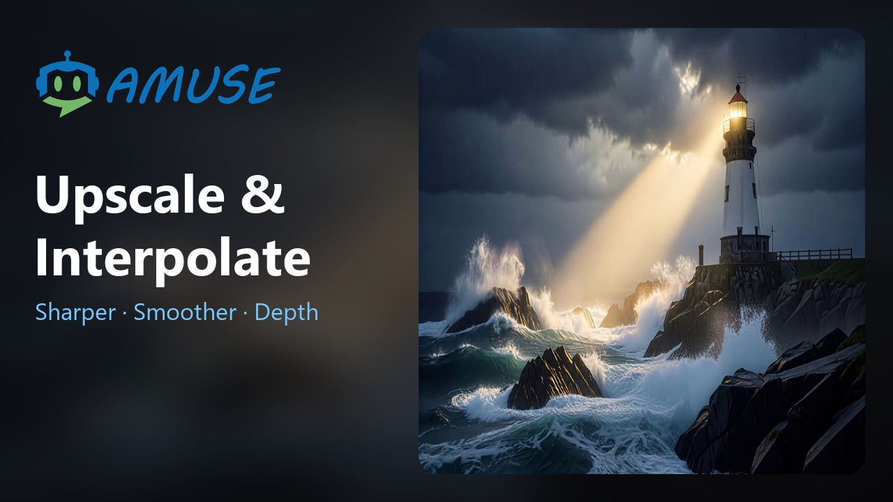
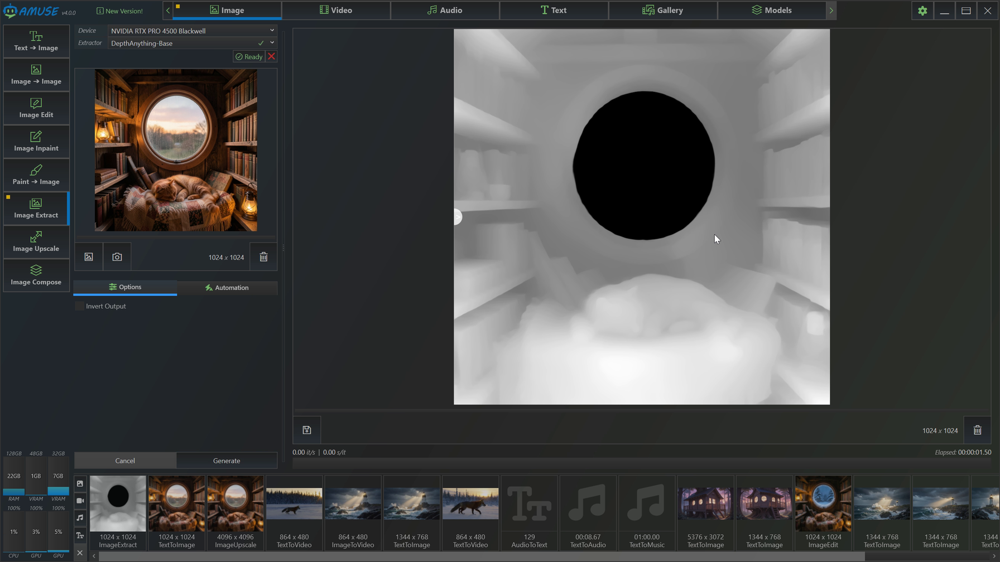

# Extractors

*Video: Upscale, extract and interpolate (extractors start at 1:35).*

An **extractor** turns an image or video into a *map*: a depth map, the edges, a body pose, or a cut-out with the background removed. Maps are useful on their own (for example, a transparent cut-out) and as guides for other tools, such as a ControlNet in **Image → Image**.

**Before you start:** download an extractor from the **Models** page (**Model Type**: **Extractors**). They're small and fast.

| Extractor | Makes |
|---|---|
| **DepthAnything** (Small, Base, Large), **Depth** | A depth map: lighter is closer, darker is further away. |
| **Canny**, **SoftEdge**, **LineDrawing** | The edges or a line drawing of the image. |
| **OpenPose** (Body7, Coco) | A stick-figure skeleton of each person's pose. |
| **RMBG 1.4 / 2.0**, **BiRefNet** | The subject cut out from its background, or a mask. |

---

## Extract from an image

1. Click **Image** at the top, then **Image Extract** on the left.
2. Choose an **Extractor** and click **Load**.
3. Drag an image from your **history** onto the input (or open a file).
4. Click **Generate**. Drag the **< >** handle to compare the map with the original.

### Options

The options depend on the type of extractor:

| Extractor type | Options |
|---|---|
| Depth and edges | **Invert Output** swaps light and dark. |
| Background removal | **Background Mode**: remove the background or the foreground, or output a mask of either. |
| Pose | **Max Detections** (0 means no limit), **Body Confidence** and **Joint Confidence** (how sure the model must be), **Bone Radius**, **Bone Thickness** and **Joint Radius** (how the skeleton is drawn), **Alpha**, and **Transparent** (draw the skeleton on a transparent background). |

## Extract from a video

**Video → Video Extract** works the same way on every frame of a video, giving you a depth, edge, pose or cut-out video.

## Use a map to guide an image

In **Image → Image**, tick **Extract** and choose an extractor, then tick **Control** and choose a matching ControlNet. When you load an input image, it's turned into the map first, and the new image follows its depth, edges or pose.

---

**Related:** [Upscaling images and video](upscale.md) · [Image Edit and other image tools](../image/image-edit.md)
