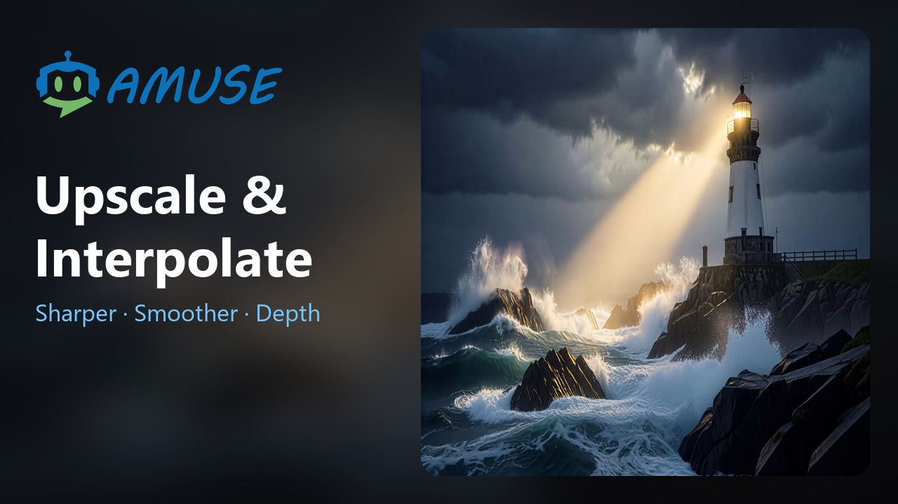
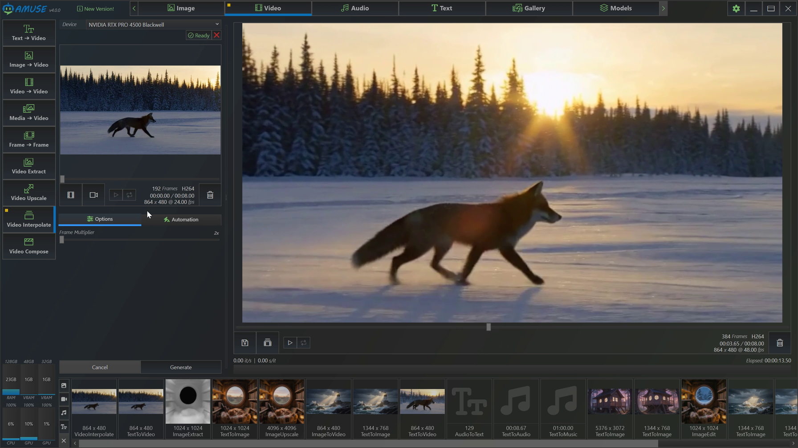

# Video interpolation

*Video: Upscale, extract and interpolate (interpolation starts at 2:22).*

**Video Interpolate** adds new in-between frames to a video, so motion looks smoother. A 24 fps video becomes 48 fps, with the same length and sound.

There's nothing to download: the interpolation model is built in.

---

## Make a video smoother

1. Click **Video** at the top, then **Video Interpolate** on the left.
2. Choose the **Device** and click **Load**.
3. Drag a video from your **history** onto the input, or use the film button to open a video file.
4. Click **Generate**.

The info under each player shows the change: here 192 frames at 24 fps become 384 frames at 48 fps. An 8 second video takes about 15 seconds.

| Option | What it does |
|---|---|
| **Frame Multiplier** | How many frames to make from each original frame (2× doubles the frame rate). |

---

## Tips

- Interpolate *after* upscaling: there are fewer frames to upscale, so it's faster.
- AI video often has small jumps between frames; interpolation smooths them out.
- For slow motion, interpolate, then play the result at the original frame rate in a video editor (or **Video Compose**).
- Use the **Automation** tab with a **Video Folder** to interpolate many videos in one go.

---

**Related:** [Upscaling images and video](upscale.md) · [Extractors](extract.md)
