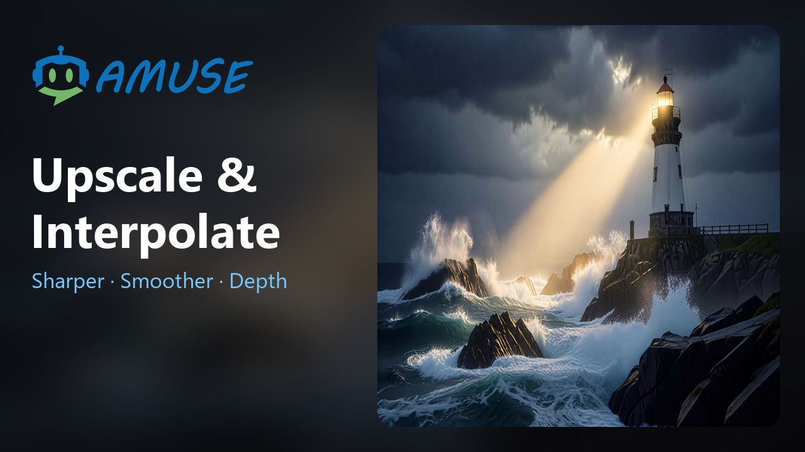
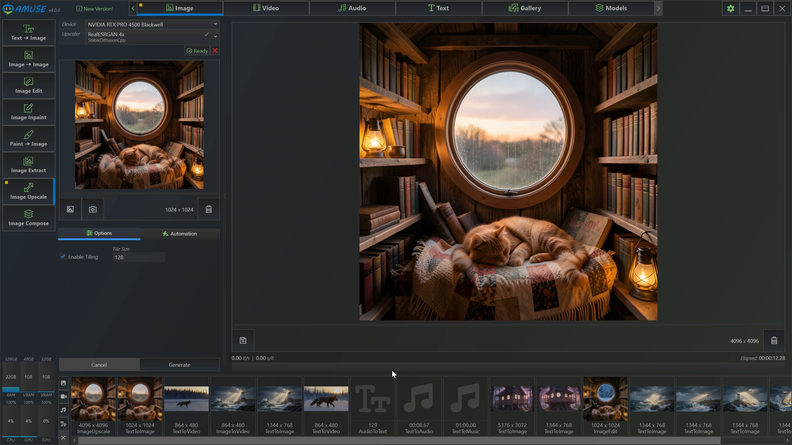
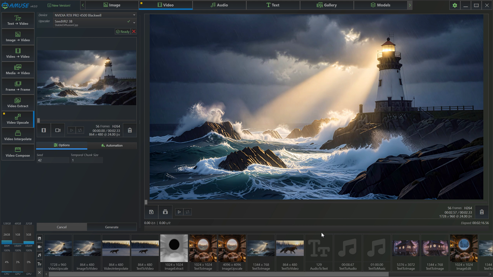

# Upscaling images and video

*Video: Upscale, extract and interpolate (image upscaling starts at 0:20, video upscaling at 3:06).*

An **upscaler** makes an image or video larger and sharper, adding detail instead of just stretching the pixels. Use it on anything you've made in Amuse, or on your own photos and videos.

**Before you start:** download an upscaler from the **Models** page (**Model Type**: **Upscalers**).

| Upscaler | Scale | Good for |
|---|---|---|
| **RealESRGAN 4x** | 4× | Photos and general images. Fast and small. |
| **AnimeSharp** and **UltraSharp** models | 2× or 4× | Illustrations, anime and line art (AnimeSharp); crisp detail (UltraSharp). |
| **SeedVR2 3B / 7B** | 2× | Video. It looks at several frames at once, so detail stays steady from frame to frame. Also excellent for single images. |
| **RelayVSR** | 2× or 4× | Video, using reference frames. |

---

## Upscale an image

1. Click **Image** at the top, then **Image Upscale** on the left.
2. Open the **Upscaler** list and choose a model. The filter button at the bottom of the list shows only the upscalers you've installed.
3. Click **Load**.
4. Drag an image from your **history** onto the input, or use the picture button to open a file. Any size is accepted.
5. Click **Generate**.

Drag the **< >** handle across the result to compare it with the original. The new size is shown at the bottom right, and the result is saved to your history.

| Option | What it does |
|---|---|
| **Enable Tiling** | Upscales the image in tiles, so very large images fit in memory. |
| **Tile Size** | The tile size in pixels. Smaller tiles use less memory. |
| **Tile Overlap** | How much neighbouring tiles overlap, to hide the joins (ONNX upscalers). |

> To upscale every image as it's generated, tick **Upscale** in Text to Image instead (see [LoRA and inline upscale](../image/lora-and-upscale.md)).

---

## Upscale a video

1. Click **Video** at the top, then **Video Upscale** on the left.
2. Choose an upscaler, for example **SeedVR2 3B**, and click **Load**.
3. Drag a video from your history onto the input, or use the film button to open a video file.
4. Click **Generate**.

The video keeps its frame rate, length and sound. A 2.3 second clip at 864 × 480 takes about two minutes to become 1728 × 960 with SeedVR2 3B on an RTX-class card.

| Option | Upscaler | What it does |
|---|---|---|
| **Seed** | SeedVR2, RelayVSR | The noise seed used by the upscaler. |
| **Temporal Chunk Size** | SeedVR2 | How many frames are processed together. Lower values use less memory. |
| **Window Size** | RelayVSR | The spacing of the reference frames. |
| **Enable Tiling** / **Tile Size** | image upscalers | Image upscalers can upscale video too, one frame at a time. |

---

## Many files at once

On the **Automation** tab, choose an **Image Folder** (or **Video Folder**) and click **Automate** to upscale every file in it. Tick **Output Location** to save the results to a folder as well as to history.

---

**Related:** [Video interpolation](interpolate.md) · [Extractors](extract.md) · [LoRA and inline upscale](../image/lora-and-upscale.md)
