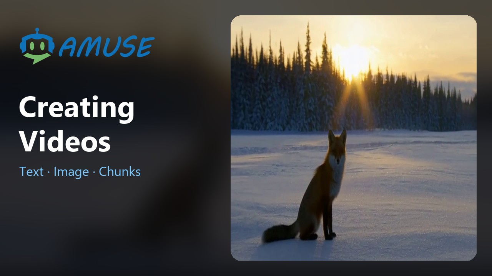
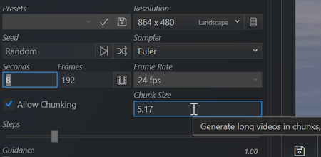
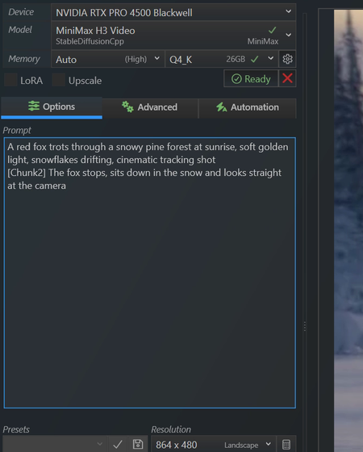
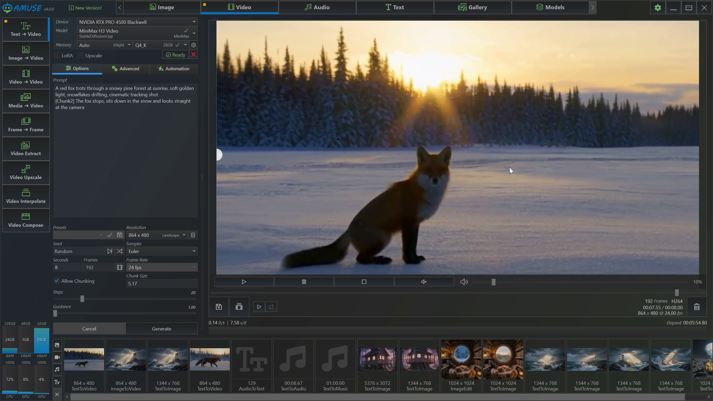

# Long videos with chunking

[](https://youtu.be/FsD5kBkixjc)

*Video: Creating videos in Amuse (chunking starts at 2:27).*

A video model can only make a clip of a certain length in one pass, and longer clips need more memory. **Chunking** makes a long video as a series of shorter chunks. Each chunk continues from the last frame of the one before, and Amuse joins them into one video with matching colours and a smooth soundtrack.

You can also give each chunk its own prompt, so the story moves on as the video plays.

**Models that support chunking:** MiniMax H3 Video, LTX-2.3 and LTX-2.5 (Dev and Distilled), Wan 2.2 5B and others marked in the model list. Chunking works in **Text → Video** and **Image → Video**.

---

## 1. Turn on chunking

1. Load a video model in **Text → Video** or **Image → Video**.
2. Tick **Allow Chunking**.
3. Set the total length in **Seconds** (or **Frames**). With chunking on, the length is no longer limited to one pass.
4. **Chunk Size** sets the length of each chunk. Smaller chunks use less memory; larger chunks give each part more room to develop. The default is a good starting point.



For example, with MiniMax H3 at 24 fps, **8 seconds** is 192 frames. With the default chunk size of 5.17 seconds (124 frames), it's made as two chunks.

## 2. A prompt for each chunk

Text at the top of the prompt is used for **every** chunk. Add a tag such as `[Chunk2]` and the text after it is added from that chunk onwards:

```
A red fox trots through a snowy pine forest at sunrise, soft golden light,
snowflakes drifting, cinematic tracking shot
[Chunk2] The fox stops, sits down in the snow and looks straight at the camera
```



How the tags work:

| Rule | Example |
|---|---|
| Text before the first tag goes into every chunk. | The fox and forest description above. |
| Text after `[ChunkN]` is added from chunk N onwards, until a higher tag takes over. | `[Chunk2]` applies to chunks 2, 3, 4… unless there's a `[Chunk4]`. |
| A tag with nothing after it goes back to the opening text only. | `[Chunk5]` on its own line. |
| Tags higher than the number of chunks are ignored. | `[Chunk9]` in a three-chunk video. |
| Tags are not case-sensitive, and spaces are allowed. | `[chunk 2]` works too. |
| The **Negative Prompt** can use the same tags. | |
| Without chunking, only the opening text (and any `[Chunk1]` text) is used. | |

A longer example, 25 seconds with LTX-2 in five chunks:

```
A red fox walks through a snowy forest, cinematic lighting
[Chunk2] the fox stops and looks at the camera
[Chunk4] the fox runs off into the trees
[Chunk5]
```

| Chunk | Prompt used |
|---|---|
| 1 | the opening text |
| 2 and 3 | the opening text + "the fox stops and looks at the camera" |
| 4 | the opening text + "the fox runs off into the trees" |
| 5 | the opening text only |

## 3. Generate

Click **Generate**. The progress bar shows "Generating chunk 1 of 2…" and so on. Each chunk is written to the video as soon as it's finished, so memory use stays the same however long the video is.



---

## Tips

- Keep the opening text describing the scene and style that should stay the same, and use chunk tags only for what changes.
- Change one thing per chunk; big jumps between chunks can look like a cut.
- In **Image → Video**, the **First Frame** starts the first chunk, and the **Last Frame** ends the last chunk.
- Each chunk uses the next seed (seed, seed + 1, …), so a fixed seed repeats the whole video.
- Chunking is turned off when a **Latent Upscale** mode is set on the Advanced tab.

---

**Related:** [Text to Video and Image to Video](text-to-video.md)
