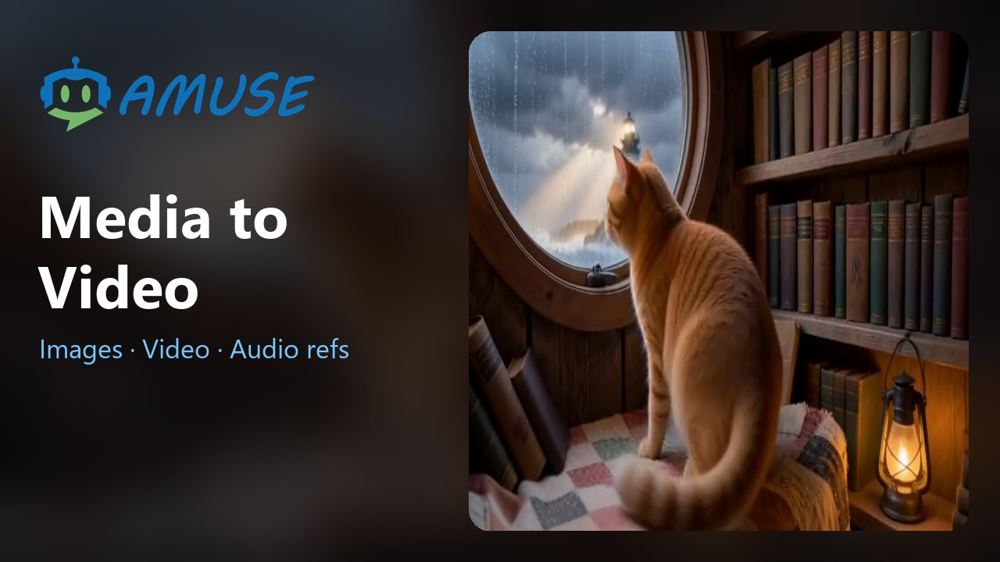
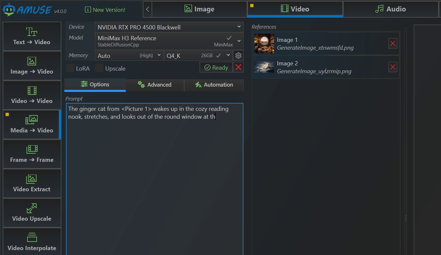
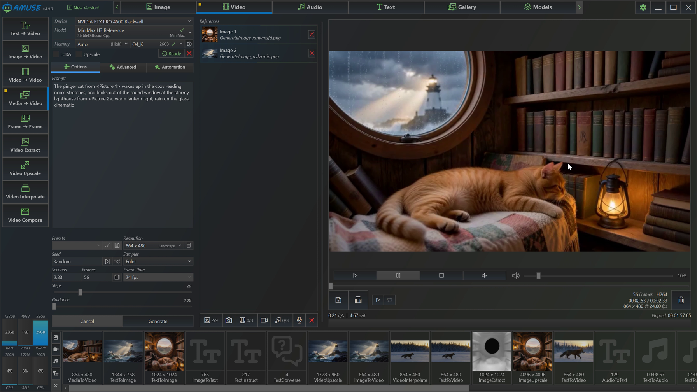

# Media to Video

[](https://youtu.be/Dr6RmL1c8rU)

*Video: Media to Video.*

**Media to Video** makes a new video guided by your own *references*: images, videos and audio. Put a character from one picture into the scene from another, copy the movement from a video, or use a sound for the soundtrack.

**Before you start:** download **MiniMax H3 Reference** from the **Models** page (26 GB at Q4_K, 36 GB at Q8_0). The ClipProj 4B and 8B versions use a smaller text encoder and need less memory.

---

## 1. Load the model

1. Click **Video** at the top, then **Media → Video** on the left.
2. Choose the **Device**, pick **MiniMax H3 Reference**, and click **Load**.

## 2. Add references

Drag items from your **history** (or files from File Explorer) onto **References**, or use the buttons under the list:

| Button | Adds | Limit (MiniMax H3 Reference) |
|---|---|---|
| Image / camera | Image references | 9 |
| Film / video camera | Video references | 3 |
| Note / microphone | Audio references | 3 |

The counters on the buttons (for example `2/9`) show how many you've added. Each reference is numbered in order: **Image 1**, **Image 2**, **Video 1** and so on. Video and audio references have a **Crop** button to use just part of them; the red **✕** removes one, and the red **✕** at the end of the bar clears them all.



## 3. Refer to them in the prompt

Refer to each image reference as `<Picture N>`, where N is its number, and describe how they come together:

```
The ginger cat from <Picture 1> wakes up in the cozy reading nook, stretches, and looks
out of the round window at the stormy lighthouse from <Picture 2>, warm lantern light,
rain on the glass, cinematic
```

## 4. Generate

Click **Generate**. A 2.3 second clip takes about two to four and a half minutes on an RTX-class card. Video references are resized to the video size and trimmed to its length first; their own sound is included.



The options (**Resolution**, **Seconds**, **Seed**, **Steps** and so on) are the same as in [Text to Video](text-to-video.md). Chunking isn't available in Media to Video.

---

## Tips

- Use clear, simple reference images: one subject on a plain background works best for a character.
- Describe the action and the camera, as in Text to Video. The references set the look; the prompt sets what happens.
- Try a short video reference to copy its motion, and keep the prompt about the subject and setting.

---

**Related:** [Text to Video and Image to Video](text-to-video.md) · [Long videos with chunking](chunking.md)
