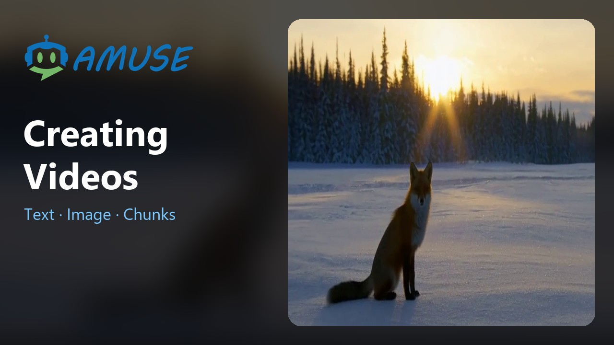
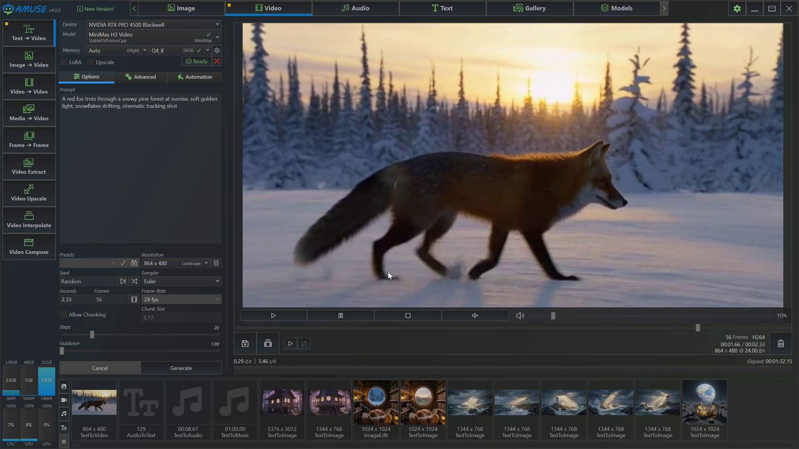
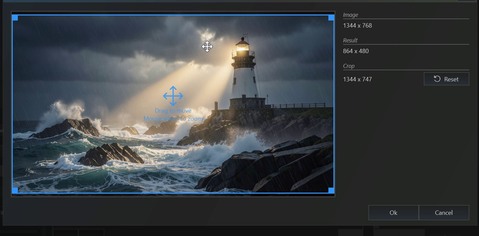
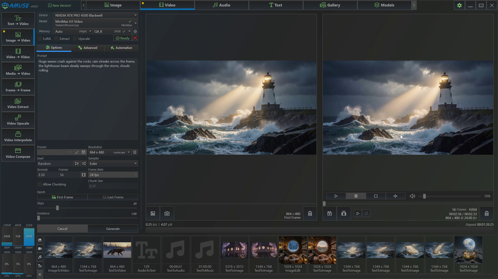

# Text to Video and Image to Video

[](https://youtu.be/FsD5kBkixjc)

*Video: Creating videos in Amuse (Text to Video starts at 0:21, Image to Video at 1:21).*

**Text to Video** makes a video clip from a written description. **Image to Video** starts from a picture you already have and brings it to life. Some models, such as **MiniMax H3 Video** and **LTX-2**, also create the sound for each clip.

**Before you start:** download a video model from the **Models** page (set **Media Type** to **Video**). Video models are large:

| Model | Memory | Notes |
|---|---|---|
| **MiniMax H3 Video** | 26 GB (Q4_K) to 36 GB (Q8_0) | Video and sound; Text to Video and Image to Video with first and last frames. |
| **LTX-2.3 / LTX-2.5 Distilled** | 38 GB and up | Video and sound; fast distilled models. |
| **Wan 2.2 5B** | smaller | A good choice for cards with less memory. |

Amuse loads parts of the model as they're needed, so a model can run on a card with less memory than the total shown, at some cost in speed.

---

## Text to Video

1. Click **Video** at the top of the window, then **Text → Video** on the left.
2. Choose the **Device** and **Model**, and click **Load**.
3. Describe the scene in **Prompt**. Say what happens and how the camera moves, for example:

   ```
   A red fox trots through a snowy pine forest at sunrise, soft golden light,
   snowflakes drifting, cinematic tracking shot
   ```

4. Click **Generate**. The video plays as soon as it's ready and is saved to your history.



### Options

| Option | What it does |
|---|---|
| **Resolution** | The size and shape of the video, from the model's recommended sizes. The calculator button switches to **Width** and **Height** boxes. |
| **Seed** | **Random** gives a different video each time; a fixed number repeats it. |
| **Sampler** | The sampling method; the model's default is usually best. |
| **Seconds** / **Frames** | The length of the video. Type the seconds, and the box beside it shows the number of frames. The film button switches to typing frames instead. Amuse rounds to a frame count the model accepts. |
| **Frame Rate** | The frames per second the model generates at (fixed for most models). |
| **Allow Chunking** / **Chunk Size** | Make longer videos in several chunks (see [Long videos with chunking](chunking.md)). |
| **Steps** / **Guidance** | Refinement steps and prompt strength. Every model starts with its recommended values. |

Generating video takes much longer than an image: a 2.3 second MiniMax clip takes about a minute and a half on an RTX-class card. The progress bar shows each step.

### The video player

The result pane plays the video with its sound. The buttons under it **Save** the video, switch to the **Video Frame Viewer** to step through single frames, and play or loop it. The bottom right shows the frame count, codec, length, size and frame rate. Drag the **< >** handle across the video to compare it with the previous result.

---

## Image to Video

1. Click **Image → Video** on the left and click **Load**.
2. Drag an image from your **history** onto **First Frame** (or click the picture button under it to open a file).
3. If the image is a different shape from the video, the **Crop Image** dialog opens. Drag the frame to choose the part to use, use the mouse wheel to zoom, and click **Ok**.

   

4. Describe how the scene should move, and click **Generate**.



**First Frame and Last Frame.** Models that support it show an **Inputs** option with **First Frame** and **Last Frame**. Turn on **Last Frame** to add a second image, and the video moves from the first image to the last. This is a great way to control exactly where a video ends up.

**Extract.** Tick **Extract** and choose an extractor to turn the first frame into a depth map, edges or a pose before it's used.

---

## Tips

- Describe motion: "the camera slowly pushes in", "waves crash", "she turns and smiles". A prompt that only describes a still scene gives a still video.
- Try ideas at the default short length, and make the final version longer once you like the result.
- Use the **Automation** tab with **Seed Batch** to make several versions while you're away.
- To make the result sharper or larger, tick **Upscale** and choose a video upscaler such as **SeedVR2** (see [Upscaling images and video](../tools/upscale.md)).

## Troubleshooting

| Problem | Try this |
|---|---|
| Out of memory | Choose a smaller quality (Q4_K), set **Memory** to **Low**, or lower the resolution. |
| The video barely moves | Add movement words to the prompt, and describe what changes over time. |
| The video is too short | Increase **Seconds**, or use chunking for videos longer than one pass allows. |

---

**Related:** [Long videos with chunking](chunking.md) · [Text to Image](../image/text-to-image.md)
